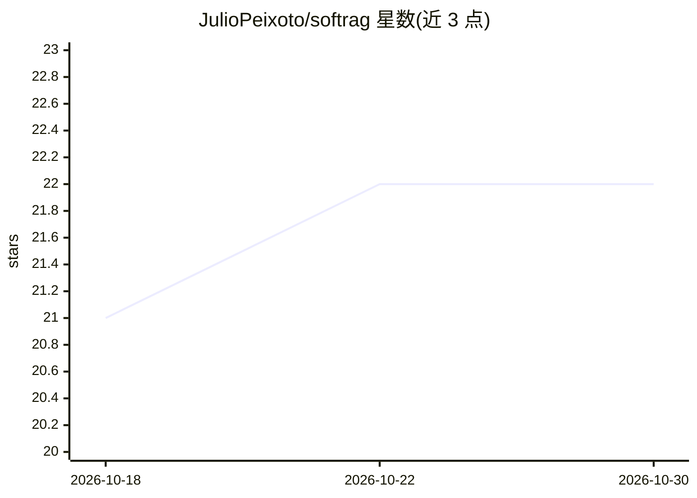

# JulioPeixoto/softrag

⭐ 22 · Python · MIT · 推送 2026-10-21 · [GitHub](https://github.com/JulioPeixoto/softrag) · 个人维护

**单 SQLite 文件内嵌的本地优先混合检索 RAG 引擎库**

面向开发者的嵌入式 RAG 引擎：分块、元数据、向量索引与 FTS5 全文索引全部存于一个 .db 文件，无需服务器或账号。核心安装仅依赖 sqlite-vec，模型后端（OpenAI/Anthropic/Ollama/sentence-transformers/自定义）可选可插拔，未配置时回退到无依赖的 hash 嵌入器。检索采用稠密向量与 BM25 双路并用 RRF 融合，支持 MMR、邻块扩展、元数据过滤 DSL、多格式文档摄入（PDF/Office/网页/代码/图片）。附 CLI、异步接口、评测模块（recall/MRR/nDCG）与 rerank 扩展。声明的限制：单文件嵌入式索引，无分片/复制/多写集群，向量搜索为精确全扫，适合数十万 chunk 级而非 5000 万+向量。

## 筛选速览

| 维度 | 判定 | 备注 |
|---|---|---|
| AI 角色 | `ai-ecosystem` | LLM/agent 周边工具 |
| 许可风险 | `permissive` | MIT |
| 部署形态 | `library` | 以包/库形式分发 |
| 模型依赖 | local-ok | 支持本地模型 |
| 硬件要求 | — | 无带数字的原话,不猜 |
| 安装摩擦 | `low` | 无编译、无系统依赖或容器化 |
| 成熟度 | — | 结构信号不足 |

## 能力要点

- 全部索引存于单个 SQLite 文件，可 cp/commit/备份
- 稠密向量 + BM25 双路检索并用 RRF (k=60) 融合
- 核心安装仅 1 个依赖 (sqlite-vec)，模型后端可选可插拔
- 内置文档提取（PDF/Office/网页/代码/图片）、CLI、评测（recall/MRR/nDCG）与 rerank

## 适用场景

- 给应用/CLI/桌面工具随包附带一个知识库索引，免部署向量数据库服务
- 离线环境（如无网络的笔记本）下做文档问答与检索
- 测试套件中用真实索引验证 RAG 检索效果
- 对检索参数做 A/B 对比评测与调优

## 场景标签

`RAG` · 领域:知识与检索

## 证据(README 行号)

> L5:  The embedded RAG engine: hybrid retrieval in a single SQLite file, no server, no vendor account.
> L14: delete. The core install is one dependency (`sqlite-vec`); every model backend
> L217: With no models passed, `connect()` walks this order:

## 星数曲线

2026-10-18 21 → 2026-10-30 22（+1）

---
*卡片 v1 · prompt 1.4 · 生成 2026-10-27 · 置信度 high · 依据 README sha `0a97d1f7a631` · [字段定义](../../DATASET.md)*
