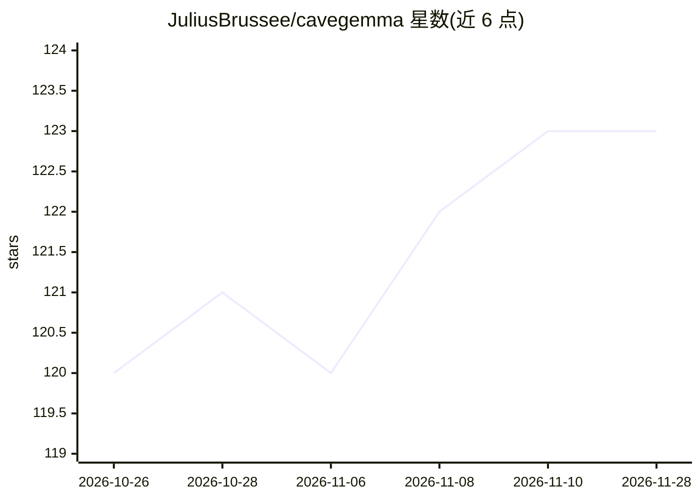

# JuliusBrussee/cavegemma

⭐ 123 · Python · 推送 2026-11-17 · [GitHub](https://github.com/JuliusBrussee/cavegemma) · [官网](https://huggingface.co/JBrussee/gemma-4-31B-caveman) · 个人维护

**以穴居人简练风格输出回答的 Gemma 4 31B LoRA 微调模型**

对 google/gemma-4-31B-it 做 QLoRA 微调得到的模型，将 caveman 风格规则集写入权重，使回答无需系统提示即输出简练文本；在 193 组保留对上输出 token 较冗长参考答案少约 27%，代码块按字节原样复现 96–100%。提供 bf16 合并权重（62.5 GB）与 LoRA 适配器（534 MB）两种形式，托管于 Hugging Face；训练在单张 96 GB GPU 上约 50 分钟完成，README 给出完整复现流程与已知局限说明。

## 筛选速览

| 维度 | 判定 | 备注 |
|---|---|---|
| AI 角色 | `ai-native` | 本体是模型或模型工具 |
| 许可风险 | `none` | — |
| 部署形态 | `None` |  |
| 模型依赖 | — | README 未给出锁定关系 |
| 硬件要求 | — | 无带数字的原话,不猜 |
| 安装摩擦 | `low` | 无编译、无系统依赖或容器化 |
| 成熟度 | — | 结构信号不足 |

## 能力要点

- 提供合并权重与 LoRA 适配器两种发布形式
- 输出 token 较冗长参考答案减少约 27%（193 保留对）
- 训练数据由 claude -p 与 codex exec 依据 SKILL.md 规则集合成
- 各阶段按 key-hash 保存并可断点续跑

## 适用场景

- 让本地模型直接输出简练回答而无需风格提示词
- 在无法修改系统提示的宿主或 agent 框架中保持简练风格
- 复现一个低成本 LoRA 风格微调流程

## 场景标签

`微调` · 领域:训练与推理

## 证据(README 行号)

> L16: Gemma 4 31B, fine-tuned until it speaks caveman natively. No skill file. No system prompt. No `/caveman` toggle. Yo
> L97: |`JBrussee/gemma-4-31B-caveman`|bf16 merged|62.5 GB|Full Gemma 4 31B, caveman baked in. Drop-in.|
> L132: |Base|`google/gemma-4-31B-it`|

## 星数曲线

2026-10-26 120 → 2026-11-28 123（+3）

---
*卡片 v1 · prompt 1.4 · 生成 2026-11-28 · 置信度 high · 依据 README sha `6353c6883acb` · [字段定义](../../DATASET.md)*
