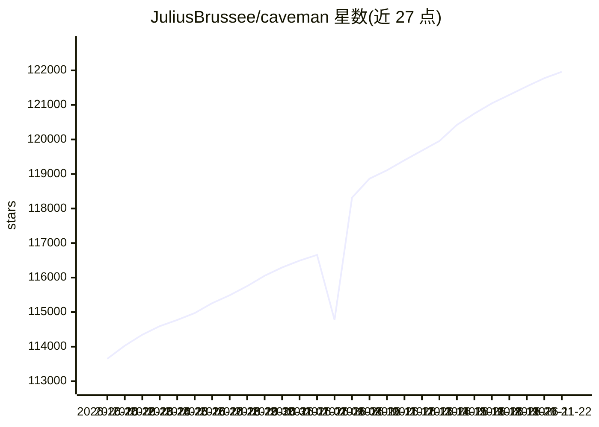

# JuliusBrussee/caveman

⭐ 121,960 · Go · Apache-2.0 · 推送 2026-11-20 · [GitHub](https://github.com/JuliusBrussee/caveman) · [官网](https://docs.caveman.so/caveman) · 个人维护

**给编程 agent 缩减回答与工具输出的技能加本地代理**

以 npm 单命令安装的本地代理加技能组合，面向使用编程 agent 的开发者。六个模块：缩短 agent 回答（代码逐字保留）、压缩日志/JSON/CSV 等工具输出（README 称整会话输入 token 减少 33.2%）、按任务自动选模型与 effort、脚本块复用（Blocks）、token 浪费修复、网页压缩。原始输出保留在本地磁盘可恢复。需 Node.js 22.13+，运行在用户自有密钥与登录上，各模块可单独开关。

## 筛选速览

| 维度 | 判定 | 备注 |
|---|---|---|
| AI 角色 | `ai-ecosystem` | LLM/agent 周边工具 |
| 许可风险 | `permissive` | Apache-2.0 |
| 部署形态 | `library` | 以包/库形式分发 |
| 模型依赖 | — | README 未给出锁定关系 |
| 硬件要求 | — | 无带数字的原话,不猜 |
| 安装摩擦 | `low` | 无编译、无系统依赖或容器化 |
| 成熟度 | `idea` | |

## 动量与使用信号

- 维护:`active` — 距上次 push 1.0 天,年发版 51,90 位贡献者
- 涨星:近 1 天 **+418**(自 20261016 起算)
- 安装:npm 包 `@caveman-ai/cli@latest` 月下载无数据
- 平台:WINDOWS / LINUX · 协议:MCP

## 能力要点

- Slash 命令 /caveman、/ultracave、/megacave 控制回答精简档位
- 工具输出压缩：CSV/日志/YAML 等文件级压缩率 82.4%（自测数据）
- Auto 模式按任务选择模型与 effort，需免费账号
- Blocks 保留 agent 脚本供复用，附八个内置块

## 适用场景

- 降低编程 agent 会话的 token 开销
- 让 agent 处理大型日志/JSON 输出时少读 token
- 复用 agent 反复重写的脚本命令

## 场景标签

 · 领域:开发者工具/LLM 基础设施

## 证据(README 行号)

> L18: **Caveman make your AI agent say less and read less. Code stay exact. Brain still big.**
> L62: After that, plain `claude` stays caveman'd. So do Codex, Gemini CLI, OpenCode, and 30+ more. It runs on your machin
> L57: npx @caveman-ai/cli@latest

## 星数曲线

2026-10-20 113,649 → 2026-11-22 121,960（+8,311）

---
*卡片 v1 · prompt 1.4 · 生成 2026-11-22 · 置信度 high · 依据 README sha `e76691af9052` · [字段定义](../../DATASET.md)*
