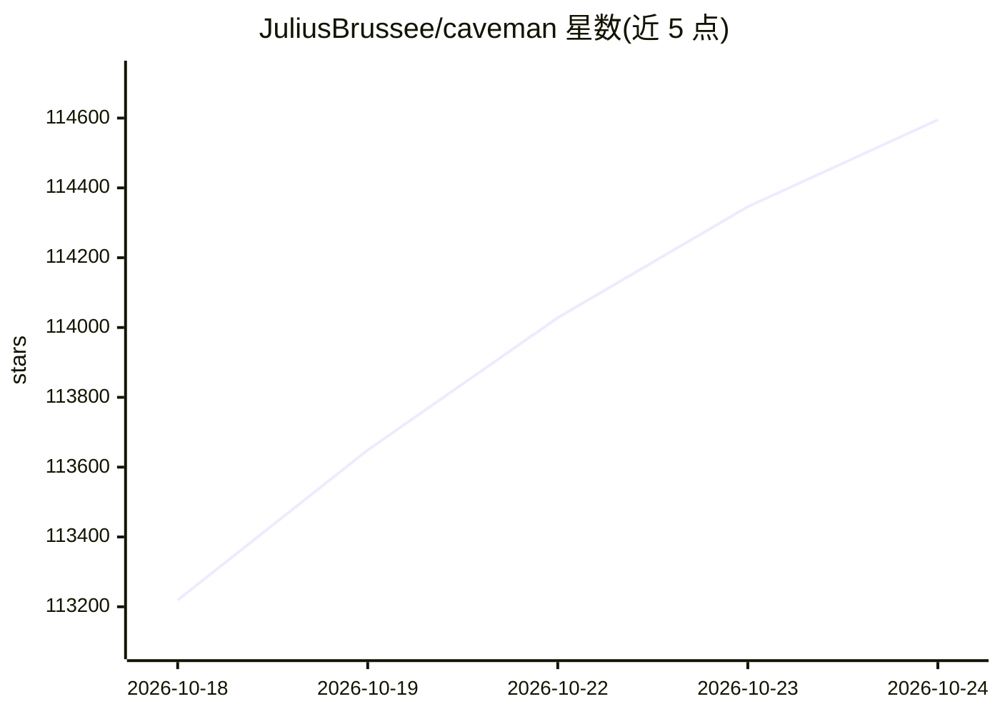

# JuliusBrussee/caveman

⭐ 114,774 · Go · Apache-2.0 · 推送 2026-10-24 · [GitHub](https://github.com/JuliusBrussee/caveman) · [官网](https://docs.caveman.so/caveman) · 个人维护

**给编码 agent 省token的代理与技能：压缩回答与读取内容**

以 CLI 安装的代理加技能组合，让编码 agent 用受控短语风格输出，压缩日志、JSON、CSV、测试输出等模型读取内容；包含六项功能：短回答、读前压缩、按任务选模型与effort的 Auto、脚本复用 Blocks、token 浪费修复、网页压缩。通过 npx 一条命令覆盖 Mac/Linux/Windows，需 Node.js 22.13+，在本机以用户自己的密钥与登录运行，支持 Claude Code、Codex、Gemini CLI 等 30+ agent；README 标注部分测量为中期数据或未复测。

## 筛选速览

| 维度 | 判定 | 备注 |
|---|---|---|
| AI 角色 | `ai-ecosystem` | LLM/agent 周边工具 |
| 许可风险 | `permissive` | Apache-2.0 |
| 部署形态 | `library` | 以包/库形式分发 |
| 模型依赖 | locked-api |  |
| 硬件要求 | — | 无带数字的原话,不猜 |
| 安装摩擦 | `low` | 无编译、无系统依赖或容器化 |
| 成熟度 | — | 结构信号不足 |

## 动量与使用信号

- 维护:`active` — 距上次 push 1.0 天,年发版 51,90 位贡献者
- 涨星:近 1 天 **+418**(自 20261016 起算)
- 安装:npm 包 `@caveman-ai/cli@latest` 月下载无数据
- 平台:WINDOWS / LINUX · 协议:MCP

## 能力要点

- 短回答技能：同一修复 63 token 降至 20，代码与命令保持原样
- 读前压缩：日志/JSON/CSV/测试输出整体会话输入 token 减少 33.2%（README 自报）
- Auto 模式按任务选择模型与 effort，README 自报成本降 54%
- Blocks 代码模式：脚本保留在仓库并在 PR 检查，提供 8 个内置 block

## 适用场景

- 降低 Claude Code 等 agent 的日常 token 开销
- 压缩 agent 读取的大体积日志与测试输出
- 按任务难度自动分配模型档位以控制成本

## 场景标签

`提示工程` · 领域:Agent 开发

## 证据(README 行号)

> L5: **Caveman make your AI agent say less and read less. Code stay exact. Brain still big.**
> L47: One command. Mac, Linux, Windows. Caveman find your agents and your logins, show what it change. Press Enter. Done.
> L49: After that, plain `claude` stays caveman'd. So do Codex, Gemini CLI, OpenCode, and 30+ more. It runs on your machin

## 星数曲线

2026-10-18 113,219 → 2026-10-24 114,595（+1,376）

---
*卡片 v1 · prompt 1.4 · 生成 2026-10-18 · 置信度 high · 依据 README sha `f790443f2802` · [字段定义](../../DATASET.md)*
