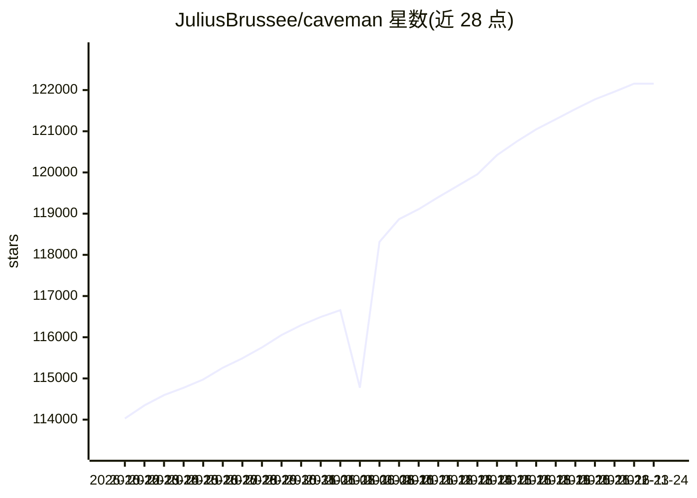

# JuliusBrussee/caveman

⭐ 122,155 · Go · Apache-2.0 · 推送 2026-11-22 · [GitHub](https://github.com/JuliusBrussee/caveman) · [官网](https://docs.caveman.so/caveman) · 个人维护

**给编码 Agent 降 token 的技能+本地代理，原文可恢复**

Caveman 由一个 slash 技能和一个本地代理组成，作用于 Claude Code、Codex、Gemini CLI 等 30+ 编码 Agent：'Say less' 用固定句式规则压缩 Agent 回答（代码与命令逐字保留），'Read less' 在模型读取前压缩日志/CSV/JSON/YAML 等大体积工具输出，原始文件保留在本地磁盘可随时取回。另含按任务自动选模型与努力档的 Auto（需免费账号）、可复用脚本的 Blocks、缓存保温与网页压缩。通过 npx 一条命令安装，需 Node.js 22.13+，使用用户已有的订阅或 key。

## 筛选速览

| 维度 | 判定 | 备注 |
|---|---|---|
| AI 角色 | `ai-ecosystem` | LLM/agent 周边工具 |
| 许可风险 | `permissive` | Apache-2.0 |
| 部署形态 | `library` | 以包/库形式分发 |
| 模型依赖 | — | README 未给出锁定关系 |
| 硬件要求 | — | 无带数字的原话,不猜 |
| 安装摩擦 | `low` | 无编译、无系统依赖或容器化 |
| 成熟度 | — | 结构信号不足 |

## 动量与使用信号

- 维护:`active` — 距上次 push 1.0 天,年发版 51,90 位贡献者
- 涨星:近 1 天 **+418**(自 20261016 起算)
- 安装:npm 包 `@caveman-ai/cli@latest` 月下载无数据
- 平台:WINDOWS / LINUX · 协议:MCP

## 能力要点

- Say less：结构化短句规则压缩 Agent 回答，代码/命令/路径逐字保留
- Read less：读取前压缩工具输出（实测整体会话输入 token 减少 33.2%），原始文件留本地可恢复
- Auto：按任务自动选择模型与努力档（需免费账号）
- Blocks：保留并复用 Agent 写过的脚本，预置 8 个 block

## 适用场景

- 在 Claude Code/Codex 等 Agent 里降低长会话的 token 开销
- 让 Agent 读取大体积日志/CSV/JSON 时减少输入 token
- 通过 Auto 按任务难度自动分配模型与努力档以降低成本

## 场景标签

 · 领域:开发者工具/LLM 成本优化

## 证据(README 行号)

> L18: **Caveman make your AI agent say less and read less. Code stay exact. Brain still big.**
> L62: After that, plain `claude` stays caveman'd. So do Codex, Gemini CLI, OpenCode, and 30+ more. It runs on your machin
> L177: Every original stays on your disk. The agent can pull it back any time.

## 星数曲线

2026-10-22 114,028 → 2026-11-24 122,155（+8,127）

---
*卡片 v1 · prompt 1.4 · 生成 2026-11-23 · 置信度 high · 依据 README sha `d03291fa4539` · [字段定义](../../DATASET.md)*
