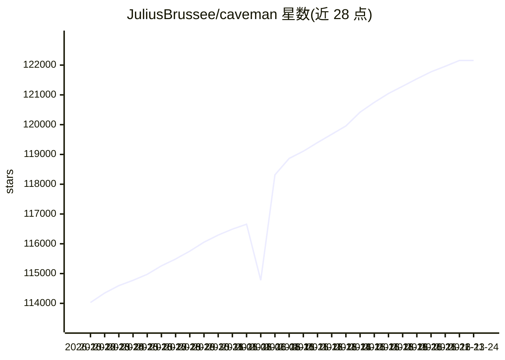

# JuliusBrussee/caveman

⭐ 122,421 · Go · Apache-2.0 · 推送 2026-11-23 · [GitHub](https://github.com/JuliusBrussee/caveman) · [官网](https://docs.caveman.so/caveman) · 个人维护

**给编码 agent 压缩回答与工具输出的 Skill+本地代理**

由 npm CLI 安装的本地代理与技能组合，让编码 agent 输出更短、读入更少的 token：代理拦截 agent 的回答与工具输出并压缩，原始内容保留在本地磁盘可恢复；'say less' 按固定规则改写回答但代码/命令/路径逐字保留，'read less' 压缩 CSV、日志、YAML、测试输出、JSON 等大输出，另有按任务自动选模型与 effort 的 Auto、可复用脚本的 Blocks 等六模块，各自可开关。支持 Claude Code、Codex、Gemini CLI、OpenCode 等 30+ agent，需 Node.js 22.13+，运行在用户自有密钥与登录上。

## 筛选速览

| 维度 | 判定 | 备注 |
|---|---|---|
| AI 角色 | `ai-ecosystem` | LLM/agent 周边工具 |
| 许可风险 | `permissive` | Apache-2.0 |
| 部署形态 | `library` | 以包/库形式分发 |
| 模型依赖 | — | README 未给出锁定关系 |
| 硬件要求 | — | 无带数字的原话,不猜 |
| 安装摩擦 | `low` | 无编译、无系统依赖或容器化 |
| 成熟度 | — | 结构信号不足 |

## 动量与使用信号

- 维护:`active` — 距上次 push 1.0 天,年发版 51,90 位贡献者
- 涨星:近 1 天 **+418**(自 20261016 起算)
- 安装:npm 包 `@caveman-ai/cli@latest` 月下载无数据
- 平台:WINDOWS / LINUX · 协议:MCP

## 能力要点

- 本地代理压缩回答与工具输出，原始内容保留在磁盘可恢复
- 'say less' 规则化改写回答，代码/命令/路径逐字不动
- 'read less' 对 CSV/日志/YAML/JSON/测试输出压缩后再给模型读
- Auto 模块按任务选择模型与 effort，Blocks 保留并复用 agent 脚本

## 适用场景

- 日常使用编码 agent 时减少输入输出 token 消耗
- 按 API 计费（如按请求付费）场景下降低 agent 使用成本
- 团队希望 agent 会话读入更小的日志与数据文件

## 场景标签

`编码 Agent` · 领域:编码与开发

## 证据(README 行号)

> L18: **Caveman make your AI agent say less and read less. Code stay exact. Brain still big.**
> L62: After that, plain `claude` stays caveman'd. So do Codex, Gemini CLI, OpenCode, and 30+ more. It runs on your machin
> L161: ## Read less: 33.2% fewer input tokens

## 星数曲线

2026-10-22 114,028 → 2026-11-24 122,155（+8,127）

---
*卡片 v1 · prompt 1.4 · 生成 2026-11-24 · 置信度 mid · 依据 README sha `c0700c1c539c` · [字段定义](../../DATASET.md)*
