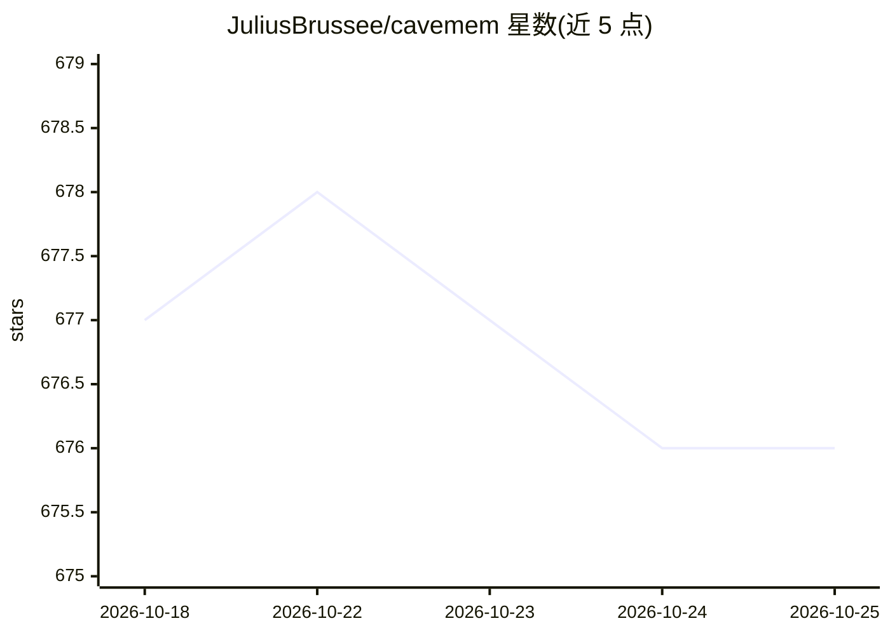

# JuliusBrussee/cavemem

⭐ 676 · TypeScript · MIT · 推送 2026-08-14 · [GitHub](https://github.com/JuliusBrussee/cavemem) · [官网](https://caveman.so/) · 个人维护

**给编码助手用的跨 IDE 持久记忆：会话压缩存本地 SQLite**

面向编码助手（Claude Code、OpenCode、Codex、Copilot 等）的跨 agent 持久记忆工具：在会话边界通过 hooks 捕获事件，用 caveman 语法压缩观测内容（约省 75% prose token，代码/路径原样保留）后写入本地 SQLite（FTS5 + 本地向量索引），agent 通过三个 MCP 工具检索自身历史。默认无网络调用，隐私内容写入前剥离。提供 CLI、只读 Web viewer 与 JSONL 导入导出。README 声明项目已冻结（2026 年 8 月），核心转入 caveman 仓库继续开发。

## 筛选速览

| 维度 | 判定 | 备注 |
|---|---|---|
| AI 角色 | `ai-ecosystem` | LLM/agent 周边工具 |
| 许可风险 | `permissive` | MIT |
| 部署形态 | `desktop` | 安装包/桌面程序 |
| 模型依赖 | local-ok | 支持本地模型 |
| 硬件要求 | — | 无带数字的原话,不猜 |
| 安装摩擦 | `low` | 无编译、无系统依赖或容器化 |
| 成熟度 | — | 结构信号不足 |

## 能力要点

- hooks 捕获 + caveman 语法压缩 + SQLite 本地存储
- SQLite FTS5 关键词 + 本地向量索引的混合检索（search/timeline/get_observations 三层 MCP）
- 支持 9 种 IDE，其中 5 种可捕获、4 种仅查询；默认零网络调用
- `<private>` 内容剥离、路径 glob 排除与密钥形态字符串擦除

## 适用场景

- 让 Claude Code 等编码助手跨会话记住项目历史与上下文
- 多个 IDE/agent 之间共享同一份本地记忆库
- 离线环境下为编码助手提供可检索的会话记忆

## 场景标签

`Agent 记忆` · 领域:Agent 开发

## 证据(README 行号)

> L16: Cross-agent persistent memory for coding assistants. Hooks fire at session boundaries, compress observations with t
> L22: - **Progressive MCP retrieval.** `search`, `timeline`, `get_observations` — agents filter before fetching.
> L26: - **Cross-IDE installers.** Claude Code, OpenCode, Codex, GitHub Copilot, Augment Code capture observations; Cursor

## 星数曲线

2026-10-18 677 → 2026-10-25 676（-1）

---
*卡片 v1 · prompt 1.4 · 生成 2026-10-21 · 置信度 high · 依据 README sha `0dd73ddeed4d` · [字段定义](../../DATASET.md)*
