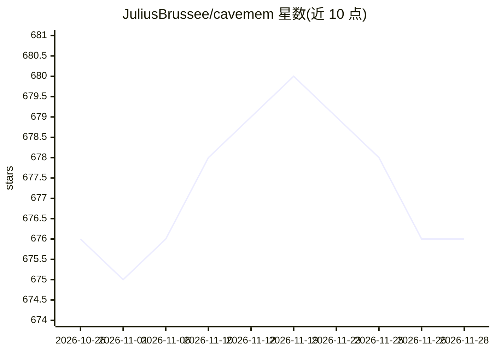

# JuliusBrussee/cavemem

⭐ 676 · TypeScript · MIT · 推送 2026-11-17 · [GitHub](https://github.com/JuliusBrussee/cavemem) · [官网](https://caveman.so/) · 个人维护

**为编程助手提供跨 IDE 的本地持久化记忆存储**

以 hooks 在会话边界捕获编码助手的会话观察，用 caveman 语法压缩后写入本地 SQLite（FTS5 + 本地向量索引混合检索），代理通过 search/timeline/get_observations 三个 MCP 工具查询自身历史。默认无网络调用；enrich 网络检索为可选项。支持 5 个 IDE 全量捕获（Claude Code、OpenCode、Codex、GitHub Copilot、Augment Code），另 4 个仅查询。通过 npm 全局安装，CLI 提供 install/status/doctor/viewer 等命令。README 声明自 2026 年 8 月起冻结，核心压缩能力转移至 caveman 仓库。

## 筛选速览

| 维度 | 判定 | 备注 |
|---|---|---|
| AI 角色 | `ai-ecosystem` | LLM/agent 周边工具 |
| 许可风险 | `permissive` | MIT |
| 部署形态 | `desktop` | 安装包/桌面程序 |
| 模型依赖 | local-ok | 支持本地模型 |
| 硬件要求 | — | 无带数字的原话,不猜 |
| 安装摩擦 | `low` | 无编译、无系统依赖或容器化 |
| 成熟度 | — | 结构信号不足 |

## 能力要点

- hooks 在会话边界自动捕获，SQLite + FTS5 + 本地向量混合检索
- caveman 语法压缩存储，代码/路径/URL 字节级保留
- 渐进式 MCP 检索（search/timeline/get_observations）
- 本地只读 Web viewer 与隐私脱敏（<private> 剥离、路径排除）

## 适用场景

- 让 Claude Code 等编程助手跨会话记住项目上下文
- 在同一台机器上让仅查询类 IDE 检索其他 IDE 捕获的记忆
- 通过 JSONL export/import 在多台设备间手动迁移记忆

## 场景标签

`Agent 记忆` · 领域:Agent 开发

## 证据(README 行号)

> L16: Cross-agent persistent memory for coding assistants. Hooks fire at session boundaries, compress observations with t
> L118: ## MCP

## 星数曲线

2026-10-26 676 → 2026-11-28 676（+0）

---
*卡片 v1 · prompt 1.4 · 生成 2026-11-24 · 置信度 high · 依据 README sha `c075523c49f8` · [字段定义](../../DATASET.md)*
