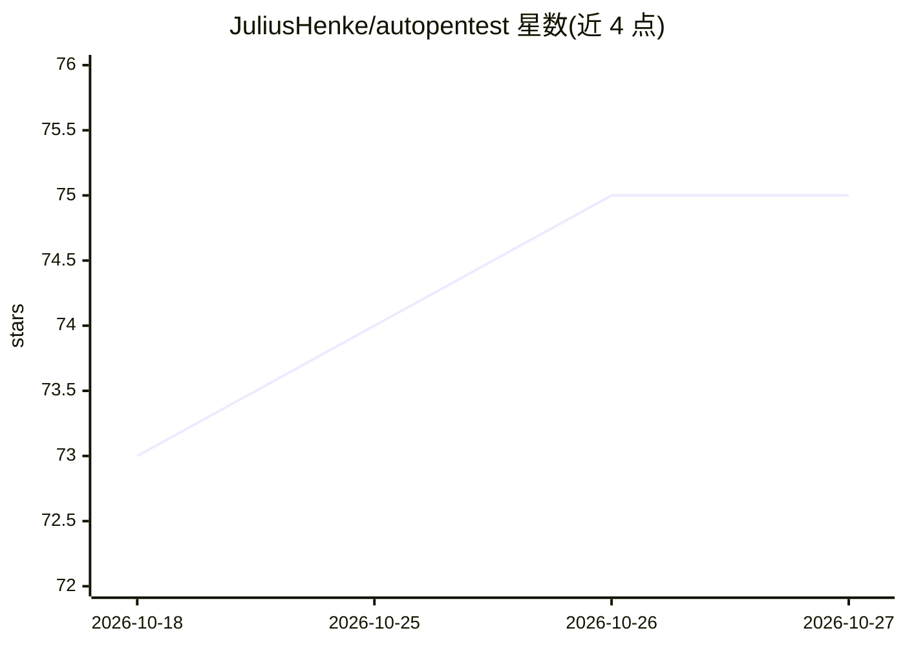

# JuliusHenke/autopentest

⭐ 75 · Python · NOASSERTION · 推送 2026-09-05 · [GitHub](https://github.com/JuliusHenke/autopentest) · [官网](https://arxiv.org/abs/2505.10321) · 个人维护

**用 LLM Agent 自动执行黑盒渗透测试的 CLI 框架**

面向安全研究者的实验性命令行工具：基于 LangChain agent 框架接入多家 LLM 提供商（默认 OpenAI/Azure OpenAI，可装 Anthropic 等扩展），对目标系统自主执行多步黑盒渗透测试，可调用外部工具与知识库（如 NVD API）。论文实验在 Hack The Box 机器上完成 15-25% 子任务，总成本 $96.20。仅限教育与研究用途，安装需从源码（Poetry），推荐在 Kali Linux 虚拟机上运行，另需 playwright 浏览器二进制。

## 筛选速览

| 维度 | 判定 | 备注 |
|---|---|---|
| AI 角色 | `ai-native` | 本体是模型或模型工具 |
| 许可风险 | `none` | NOASSERTION |
| 部署形态 | `None` |  |
| 模型依赖 | — | README 未给出锁定关系 |
| 硬件要求 | — | 无带数字的原话,不猜 |
| 安装摩擦 | `low` | 无编译、无系统依赖或容器化 |
| 成熟度 | `idea` | |

## 能力要点

- LLM agent 自主执行多步黑盒安全评估
- 通过 LangChain 集成多家 LLM 提供商（默认 openai/azure-openai，可扩展）
- 可结合外部工具与知识库（NVD API）
- 配套论文（arXiv:2505.10321）含 HTB 实验评估

## 适用场景

- 在有授权的测试环境（如 Hack The Box）中辅助渗透测试
- 研究 LLM agent 在安全评估任务中的自主能力
- 作为漏洞管理流程的辅助实验工具

## 场景标签

`网络安全` · 领域:学习与行业

## 证据(README 行号)

> L5: AutoPentest is an experimental framework for conducting **autonomous black-box penetration tests** using **Large Lan
> L6: Models (LLMs)**. Integrated with the most popular LLM providers and the **LangChain agent framework**, AutoPentest c
> L12: A recent area of increasing research is the use of Large Language Models (LLMs) in penetration testing, which promi

## 星数曲线

2026-10-18 73 → 2026-10-27 75（+2）

---
*卡片 v1 · prompt 1.4 · 生成 2026-10-24 · 置信度 high · 依据 README sha `4fa455a96dd3` · [字段定义](../../DATASET.md)*
