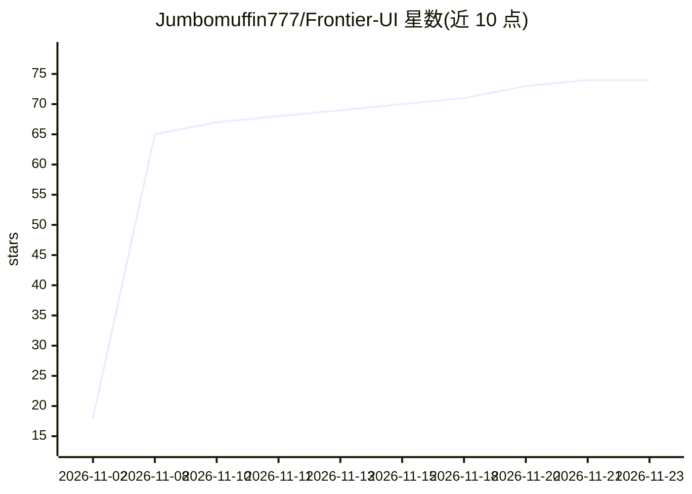

# Jumbomuffin777/Frontier-UI

⭐ 74 · Python · MIT · 推送 2026-11-21 · [GitHub](https://github.com/Jumbomuffin777/Frontier-UI) · [官网](https://openwebui.com/posts/35572bd7-6dc8-42dc-9e54-bebfb9e978cb) · 个人维护

**Open WebUI 的生成式 UI 工具：把模型输出的 JSON 渲染为富交互卡片**

以单文件 Python 工具形式嵌入 Open WebUI：模型生成一份小型 JSON spec，工具在服务端解析并渲染照片画廊、带真实路线的街道地图、地点卡片、多日行程、预算滑块、实时天气与行情、链接预览等富卡片，内嵌于对话中。照片默认来自 Wikipedia/Wikimedia/Openverse，无需 API key；可选接入 SearXNG、图片 API、自托管底图与 Craft 桥接（生成真实 Word/Excel/PowerPoint 文件，16 个 ArtCraft 应用读写转换）。要求 Open WebUI ≥ 0.6，交互地图需浏览器 WebGL，缺失时降级为静态路线草图。

## 筛选速览

| 维度 | 判定 | 备注 |
|---|---|---|
| AI 角色 | `ai-ecosystem` | LLM/agent 周边工具 |
| 许可风险 | `permissive` | MIT |
| 部署形态 | `None` |  |
| 模型依赖 | — | README 未给出锁定关系 |
| 硬件要求 | — | 无带数字的原话,不猜 |
| 安装摩擦 | `low` | 无编译、无系统依赖或容器化 |
| 成熟度 | — | 结构信号不足 |

## 能力要点

- 模型输出 JSON spec，服务端解析渲染照片/地图/行程/图表等富卡片
- 默认 keyless：照片来自 Wikipedia/Commons/Openverse，路线由 OSRM 绘制
- 可选 Craft 桥接导出真实 Word/Excel/PowerPoint/PDF 并支持 16 种文件格式读写转换
- JSON 容错修复：处理截断、双重编码、尾逗号等格式问题并反馈修正提示

## 适用场景

- 在自托管的 Open WebUI 中获得类 ChatGPT 的富媒体回答界面
- 旅行规划场景：多日路线地图、预算滑块、实时天气与日历导出
- 把聊天中的卡片一键导出为 Office 文档或读取编辑上传的各类文件

## 场景标签

`聊天机器人` `文档解析` · 领域:对话与助手

## 证据(README 行号)

> L20: The model writes one small JSON spec. The tool does the rest on the server — **finds real photos, verifies places o
> L51: 1. **Workspace → Tools → +** in Open WebUI, paste `frontier_ui.py` and save.
> L124: model ──► render_frontier_ui(spec JSON)

## 星数曲线

2026-11-02 18 → 2026-11-23 74（+56）

---
*卡片 v1 · prompt 1.4 · 生成 2026-11-18 · 置信度 high · 依据 README sha `61be2169aff1` · [字段定义](../../DATASET.md)*
