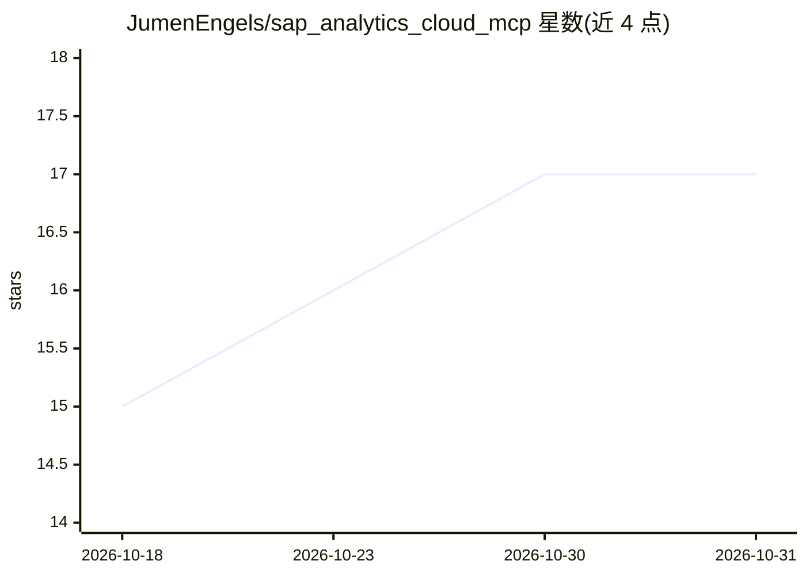

# JumenEngels/sap_analytics_cloud_mcp

⭐ 17 · TypeScript · MIT · 推送 2026-03-02 · [GitHub](https://github.com/JumenEngels/sap_analytics_cloud_mcp) · 个人维护

**将 SAP Analytics Cloud REST API 封装为 MCP 工具的接入服务器**

面向 MCP 兼容客户端（Claude Desktop、Claude Code、Cursor 等）的 SAP Analytics Cloud 接入服务器：以 OAuth 2.0 Client Credentials 认证 SAC 租户，自动管理 CSRF 令牌与会话 Cookie，把 SAC REST API 暴露为 90 个按 11 个服务域分组的工具，覆盖内容管理、数据导入导出、用户管理、内容传输等；smart_query 工具按查询特征在 OData 与 Widget Query API 间路由。附带一个可连接 SAP AI Core/Anthropic/OpenAI 的 Agent Client。需自备 SAC 租户与 OAuth 客户端，Node.js >= 18。

## 筛选速览

| 维度 | 判定 | 备注 |
|---|---|---|
| AI 角色 | `ai-ecosystem` | LLM/agent 周边工具 |
| 许可风险 | `permissive` | MIT |
| 部署形态 | `self-host` | docker 或自建部署 |
| 模型依赖 | locked-api |  |
| 硬件要求 | — | 无带数字的原话,不猜 |
| 安装摩擦 | `low` | 无编译、无系统依赖或容器化 |
| 成熟度 | — | 结构信号不足 |

## 能力要点

- 90 个 MCP 工具按 11 个服务域组织，覆盖 SAC REST API
- OAuth 2.0 认证，自动管理 CSRF 令牌与会话 Cookie
- smart_query 按 SQL 特征路由到 OData 或 Widget Query API
- 内置 Agent Client 可对接 SAP AI Core/Anthropic/OpenAI

## 适用场景

- 在 Claude Desktop 或 Cursor 中查询和导出 SAC 数据
- 通过对话管理 SAC 租户的故事、模型与用户
- 用自然语言触发 SAC 数据导入作业与 Multi Actions

## 场景标签

`数据分析` · 领域:效率与自动化

## 证据(README 行号)

> L3: An MCP (Model Context Protocol) server that exposes the SAP Analytics Cloud REST API as 90 tools consumable by any M
> L7: The server authenticates against an SAC tenant using OAuth 2.0 Client Credentials and manages CSRF tokens and sessio

## 星数曲线

2026-10-18 15 → 2026-10-31 17（+2）

---
*卡片 v1 · prompt 1.4 · 生成 2026-10-30 · 置信度 high · 依据 README sha `204c63acc7a1` · [字段定义](../../DATASET.md)*
