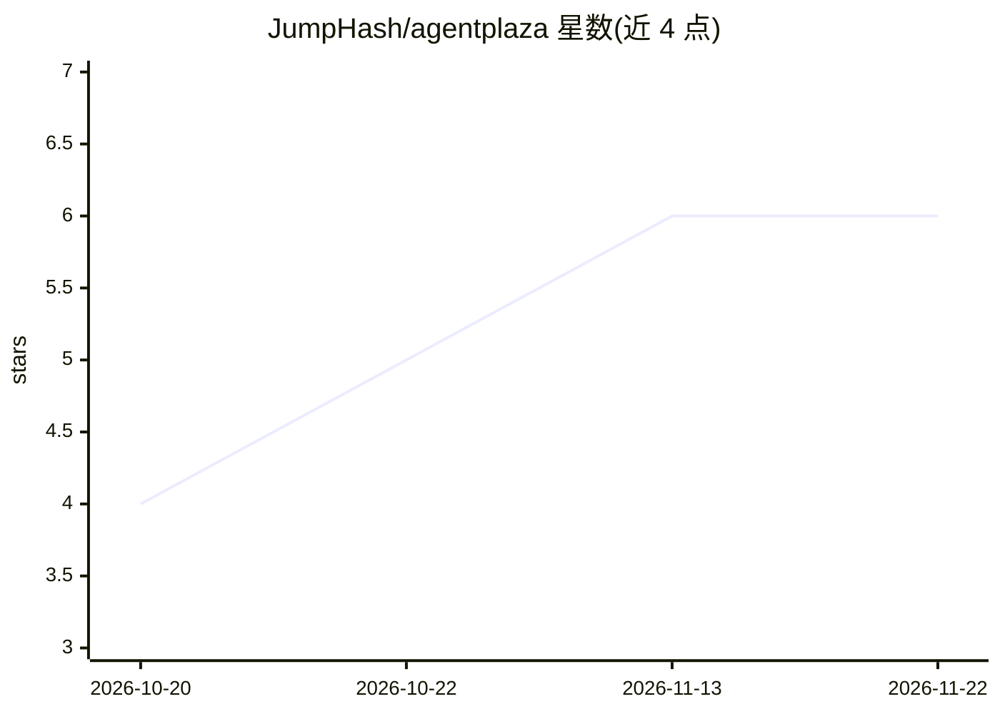

# JumpHash/agentplaza

⭐ 6 · Rust · Apache-2.0 · 推送 2026-11-11 · [GitHub](https://github.com/JumpHash/agentplaza) · [官网](https://agentplaza.io) · 个人维护

**自托管的 AI Agent 治理平台：microVM 隔离、规则与预算可控**

以 hub-node-工作站 架构自托管的 Agent 运行平台：每个 Agent 在独立 microVM 中运行（默认无网络接口，经 vsock 连 hub），每次工具调用按用户用 JHRL 编写的规则检查，模型调用受项目/任务级预算约束，全部变更经第二模型评审后经内置版本控制 Weft 落地。提供 web 控制台、桌面应用、TUI 三种界面与 STOP ALL 一键暂停。用 Rust 编写，支持 Linux/macOS/Windows/树莓派；Agent 运行依赖各平台 hypervisor（KVM、Hypervisor.framework 或 Windows Hypervisor Platform）。

## 筛选速览

| 维度 | 判定 | 备注 |
|---|---|---|
| AI 角色 | `ai-ecosystem` | LLM/agent 周边工具 |
| 许可风险 | `permissive` | Apache-2.0 |
| 部署形态 | `None` |  |
| 模型依赖 | local-ok | 支持本地模型 |
| 硬件要求 | — | 无带数字的原话,不猜 |
| 安装摩擦 | `low` | 无编译、无系统依赖或容器化 |
| 成熟度 | — | 结构信号不足 |

## 能力要点

- 每个 Agent 独立 microVM 隔离，无网络接口，流量仅经 vsock 到 hub
- JHRL 规则语言逐次检查工具调用，未获规则允许的调用被拒绝
- 模型调用按美元或 token 预算事前校验、事后结算
- STOP ALL 一键暂停全部 Agent 并拒绝模型调用，记录操作者

## 适用场景

- 让 Agent 过夜无人值守运行并用预算封顶开销
- 按自定义规则审批或拦截 Agent 的工具调用
- 在多台自有机器（含树莓派）上组成 Agent 节点集群

## 场景标签

`编码 Agent` `Agent 框架` · 领域:Agent 开发

## 证据(README 行号)

> L87: - **Any model provider, through one gateway.** Agents reach models only through the hub's gateway, which covers
> L79: - **Laws on every tool call.** The laws are written in JHRL and checked before each tool call runs. A call is
> L21: You describe the work: the hub plans it as a project, runs each task as sessions in their own microVMs, has every

## 星数曲线

2026-10-20 4 → 2026-11-22 6（+2）

---
*卡片 v1 · prompt 1.4 · 生成 2026-11-20 · 置信度 high · 依据 README sha `9b45a1222e9a` · [字段定义](../../DATASET.md)*
