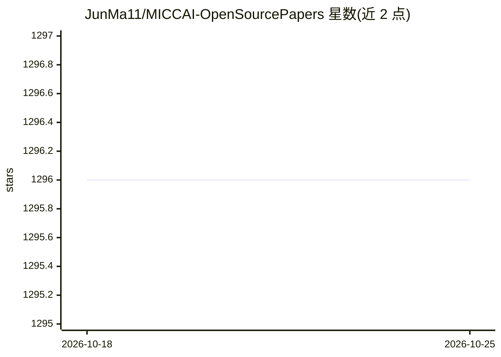

# JunMa11/MICCAI-OpenSourcePapers

⭐ 1,296 · Apache-2.0 · 推送 2026-09-23 · [GitHub](https://github.com/JunMa11/MICCAI-OpenSourcePapers) · 个人维护

**MICCAI 2026 开源论文清单：医学影像论文+代码+数据集索引**

以 Markdown 表格形式收录 MICCAI 2026 会议开放获取论文，每条记录含标题、第一作者、代码链接与数据集信息链接，数据来源为 MICCAI 开放获取论文集。条目覆盖脑血管重建、阿尔茨海默病诊断、医学图像分割、超声分析等医学影像与深度学习方向，部分条目附公开数据集链接。面向医学影像研究者与开发者用于论文检索与代码定位，本仓库不提供可运行软件，仅作知识索引。

## 筛选速览

| 维度 | 判定 | 备注 |
|---|---|---|
| AI 角色 | `ai-knowledge` | 知识聚合/清单类 |
| 许可风险 | `permissive` | Apache-2.0 |
| 部署形态 | `None` |  |
| 模型依赖 | — | README 未给出锁定关系 |
| 硬件要求 | — | 无带数字的原话,不猜 |
| 安装摩擦 | `low` | 无编译、无系统依赖或容器化 |
| 成熟度 | — | 结构信号不足 |

## 能力要点

- 表格化收录 MICCAI 2026 论文的作者、代码与数据集信息
- 数据来源为 MICCAI 开放获取论文集
- 多条目附带公开数据集链接（ADNI、PTB-XL、Zenodo 等）

## 适用场景

- 查找 MICCAI 2026 医学影像论文对应的开源代码
- 定位论文所用公开数据集的获取入口
- 了解医学影像各细分方向的论文收录情况

## 场景标签

`精选清单` · 领域:学习与行业

## 证据(README 行号)

> L1: # MICCAI 2026 Papers with Code
> L3: Source: MICCAI open-access proceedings
> L7: |Title|First author|Code|Dataset information|Paper|

## 星数曲线

2026-10-18 1,296 → 2026-10-25 1,296（+0）

---
*卡片 v1 · prompt 1.4 · 生成 2026-10-21 · 置信度 high · 依据 README sha `ced923698684` · [字段定义](../../DATASET.md)*
