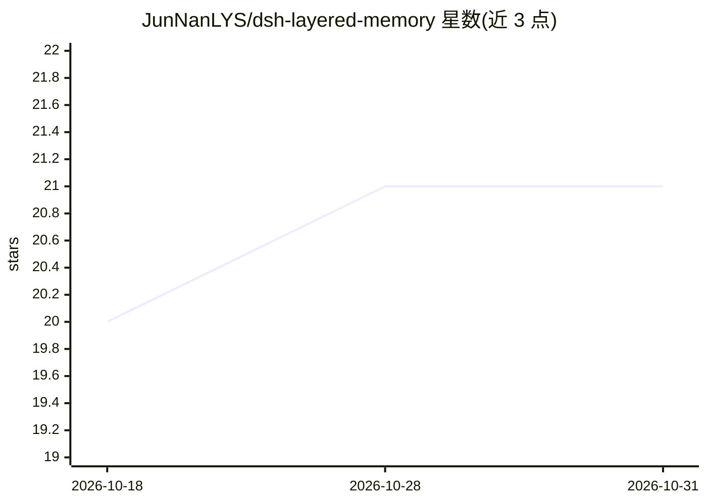

# JunNanLYS/dsh-layered-memory

⭐ 21 · TypeScript · MIT · 推送 2026-09-07 · [GitHub](https://github.com/JunNanLYS/dsh-layered-memory) · [官网](https://www.npmjs.com/package/dsh-layered-memory) · 个人维护 · 中文 README

**DeepSeek Harness 的跨会话长期记忆插件：分层蒸馏与自动召回注入**

面向 DeepSeek Harness（DSH）宿主的记忆插件：对话在后台经 L0 捕获→L1 原子记忆→L2 场景整合→L3 画像蒸馏四层处理，模型每步前把相关记忆作为合成消息注入上下文。蒸馏调用复用宿主 ctx.llm，数据双写 JSONL 与 SQLite（默认纯 BM25 关键词检索，可选远程或本地 ONNX CPU 嵌入）。提供记忆芯片档位（日常/工作/智能）、三个记忆工具、记忆工作台设置页与成本看板；要求 Node ≥ 22.16 与 DSH 0.1.2-alpha.1~rc.1。

## 筛选速览

| 维度 | 判定 | 备注 |
|---|---|---|
| AI 角色 | `ai-ecosystem` | LLM/agent 周边工具 |
| 许可风险 | `permissive` | MIT |
| 部署形态 | `library` | 以包/库形式分发 |
| 模型依赖 | locked-api |  |
| 硬件要求 | — | 无带数字的原话,不猜 |
| 安装摩擦 | `low` | 无编译、无系统依赖或容器化 |
| 成熟度 | — | 结构信号不足 |

## 能力要点

- L0–L3 四层蒸馏管线，蒸馏复用宿主 ctx.llm
- 消息侧召回注入，带长度/时间预算与同会话去重、时效加权
- 三态嵌入源：关闭（纯 BM25）/远程 OpenAI 兼容/本地 ONNX CPU 白名单模型
- 提供 memory_search 等 3 个记忆工具与记忆工作台（含成本看板）

## 适用场景

- 让我的 DSH agent 跨会话记住项目背景与个人偏好
- 把生活记忆与工作记忆分开，互不干扰
- 查看蒸馏 token 成本并管理记忆资产

## 场景标签

`Agent 记忆` · 领域:Agent 开发

## 证据(README 行号)

> L6: **DeepSeek Harness 的分层蒸馏记忆插件：对话在后台自动完成 L0 捕获 → L1 原子记忆 → L2 场景整合 → L3 画像蒸馏，模型每一步前自动把相关记忆注入上下文。**
> L16: 需要 Node ≥ 22.16 与 DeepSeek Harness **0.1.2-alpha.1 ~ 0.1.2-rc.1**（0.10.0 起

## 星数曲线

2026-10-18 20 → 2026-10-31 21（+1）

---
*卡片 v1 · prompt 1.4 · 生成 2026-10-28 · 置信度 high · 依据 README sha `0ec23080479c` · [字段定义](../../DATASET.md)*
