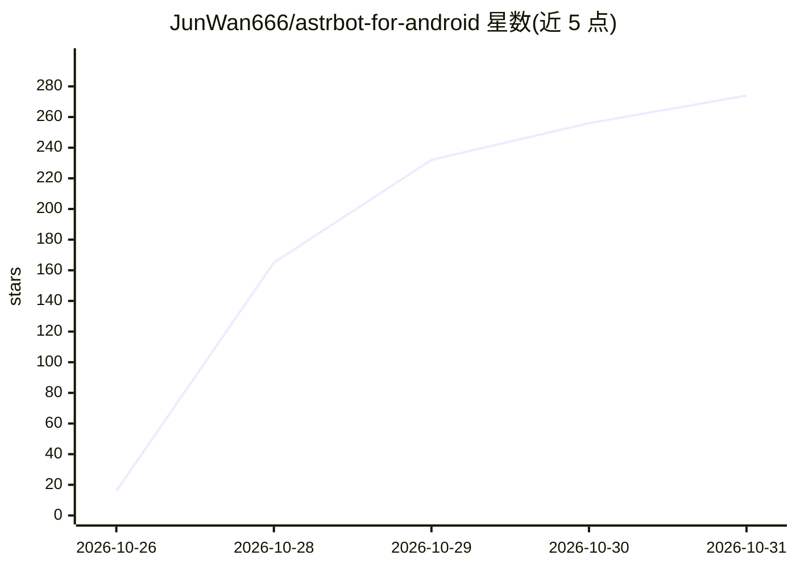

# JunWan666/astrbot-for-android

⭐ 274 · Kotlin · MIT · 推送 2026-10-29 · [GitHub](https://github.com/JunWan666/astrbot-for-android) · 个人维护 · 中文 README

**在 Android 手机本地部署管理 AstrBot 与 NapCat 的应用**

单个 APK 集成 PRoot Ubuntu 运行环境，在无需 Root 的 Android 手机上部署并管理 AstrBot 聊天机器人框架与 NapCat QQ 协议端：提供服务启停、状态监控、实时日志、备份恢复与三组件独立更新；Kotlin/Jetpack Compose 原生界面，内置 WebView 访问两者 WebUI 完成登录与模型配置，并附 SSH、Ubuntu 桌面（noVNC）与 cpolar 内网穿透扩展。要求 Android 8.0+ ARM64，完整 APK 约 720 MiB。

## 筛选速览

| 维度 | 判定 | 备注 |
|---|---|---|
| AI 角色 | `ai-ecosystem` | LLM/agent 周边工具 |
| 许可风险 | `permissive` | MIT |
| 部署形态 | `None` |  |
| 模型依赖 | — | README 未给出锁定关系 |
| 硬件要求 | — | 无带数字的原话,不猜 |
| 安装摩擦 | `medium` | 含编译或系统依赖之一 |
| 成熟度 | — | 结构信号不足 |

## 能力要点

- 单 APK 集成 PRoot Ubuntu，无需 Root 即可运行 AstrBot 与 NapCat
- 内置 WebView 访问双 WebUI，预填初始凭据
- App/AstrBot/NapCat 各自独立检查更新，支持签名校验与失败回退
- SSH、Ubuntu 桌面（noVNC）、cpolar 内网穿透按需扩展

## 适用场景

- 用一台 Android 手机跑 QQ 聊天机器人而不依赖电脑或服务器
- 在手机端完成 QQ 登录、模型接入与插件配置
- 通过内网穿透把手机上的机器人服务暴露到公网

## 场景标签

`聊天机器人` · 领域:对话与助手

## 证据(README 行号)

> L26: **AstrBot for Android（AstrBot 运行管理器）** 是面向 Android 设备的 AstrBot 与 NapCat 本地部署及运行管理应用。通过单个 APK 集成 PRoot Ubuntu 运行环境与服
> L79: 3. 打开 NapCat 后台登录 QQ，在 AstrBot 后台配置模型、平台和插件。

## 星数曲线

2026-10-26 16 → 2026-10-31 274（+258）

---
*卡片 v1 · prompt 1.4 · 生成 2026-10-28 · 置信度 high · 依据 README sha `59d1b6c13c25` · [字段定义](../../DATASET.md)*
