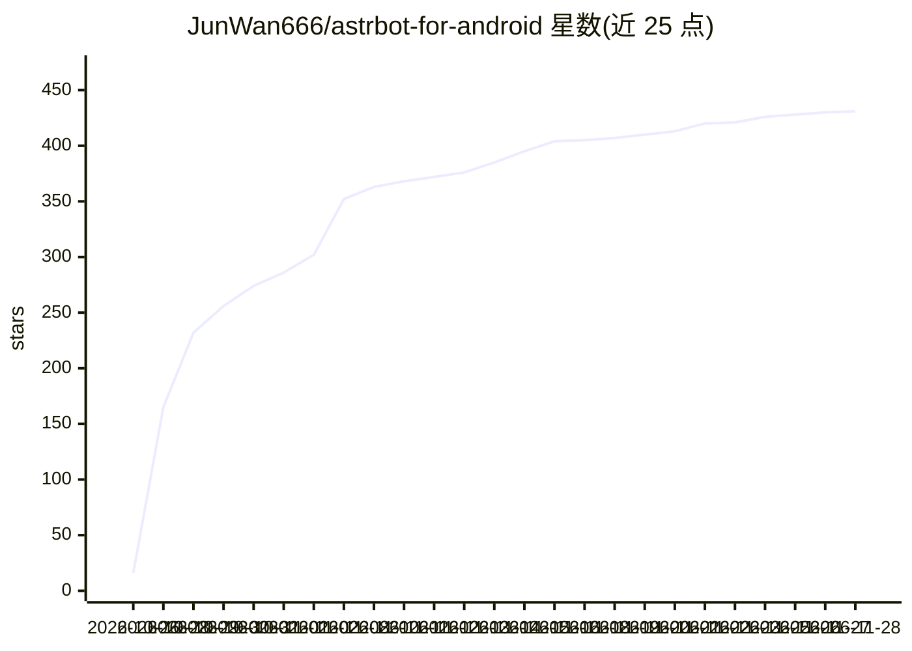

# JunWan666/astrbot-for-android

⭐ 431 · Kotlin · MIT · 推送 2026-11-27 · [GitHub](https://github.com/JunWan666/astrbot-for-android) · 个人维护 · 中文 README

**在 Android 手机上本地部署和管理 AstrBot 的管理器**

面向 Android 设备的 AstrBot 运行管理应用：单个 APK 内置 PRoot Ubuntu、AstrBot 与运行依赖，无需 Root 即可完成环境初始化、服务启停、状态监控、日志查看、备份恢复与独立在线更新。原生 Kotlin/Jetpack Compose 界面支持中英文，从首页接入 QQ 官方机器人与微信官方 ClawBot，通过内置 WebUI 配置模型、插件与人设；另提供终端、自定义 Ubuntu 任务、SSH、Linux QQ 与 cpolar 扩展。要求 Android 8.0+/ARM64。

## 筛选速览

| 维度 | 判定 | 备注 |
|---|---|---|
| AI 角色 | `ai-ecosystem` | LLM/agent 周边工具 |
| 许可风险 | `permissive` | MIT |
| 部署形态 | `None` |  |
| 模型依赖 | — | README 未给出锁定关系 |
| 硬件要求 | — | 无带数字的原话,不猜 |
| 安装摩擦 | `medium` | 含编译或系统依赖之一 |
| 成熟度 | `idea` | |

## 能力要点

- 单 APK 内置 PRoot Ubuntu 与 AstrBot，无需 Root 本地部署
- 首页接入 QQ 官方机器人与微信官方 ClawBot，扫码授权
- 服务启停、实时日志、资源概览、备份恢复与 AstrBot 独立更新
- 终端多会话与自定义 Ubuntu 任务，可选 SSH/cpolar/Linux QQ 扩展

## 适用场景

- 在闲置 Android 手机上自托管聊天机器人
- 用 QQ/微信官方机器人接入消息平台并配置模型
- 把手机当作口袋 Ubuntu 环境跑终端任务
- 通过备份恢复与独立更新管理 AstrBot 部署

## 场景标签

`聊天机器人` · 领域:对话与助手

## 证据(README 行号)

> L29: **AstrBot for Android（AstrBot 运行管理器）** 是面向 Android 设备的 AstrBot 本地部署及运行管理应用。单个 APK 提供 PRoot Ubuntu、AstrBot 与通用运行依赖，支
> L101: 原生 App 管理界面、前台任务和进程，AstrBot 在本机 PRoot Ubuntu 中运行。消息平台通过 AstrBot 调用用户配置的模型；终端、远程访问与其他接入方式独立管理。
> L103:  项目架构：原生 App 管理本机 AstrBot、终端与任务，连接 QQ 官方机器人、微信官方 ClawBot 和模型 API

## 星数曲线

2026-10-26 16 → 2026-11-28 431（+415）

---
*卡片 v1 · prompt 1.4 · 生成 2026-11-25 · 置信度 high · 依据 README sha `372c22f7985e` · [字段定义](../../DATASET.md)*
