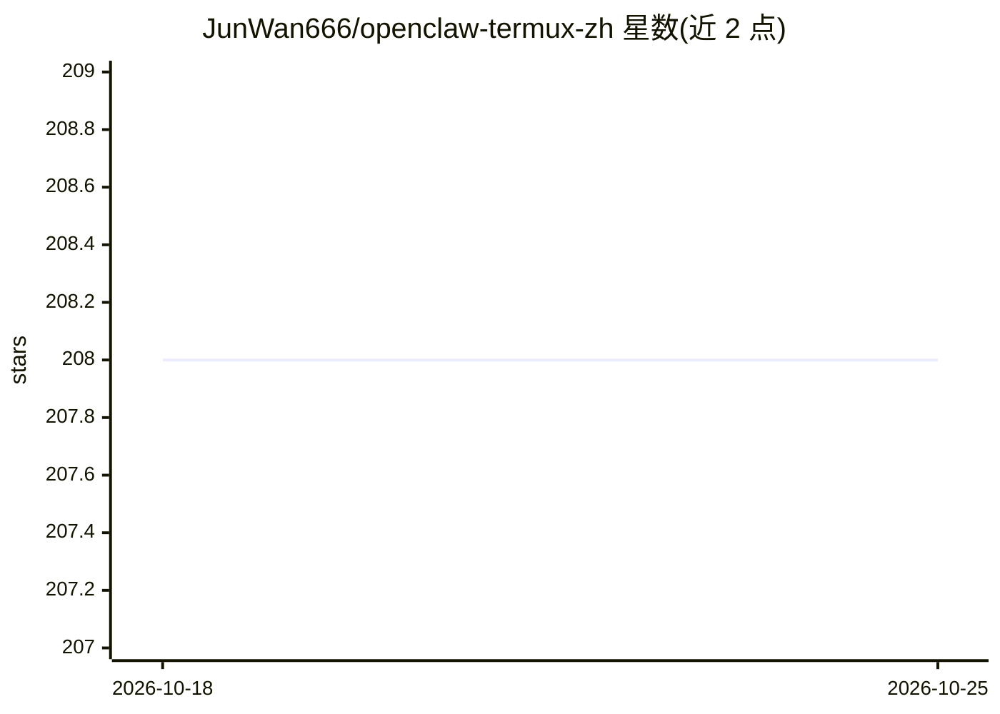

# JunWan666/openclaw-termux-zh

⭐ 209 · Dart · MIT · 推送 2026-09-01 · [GitHub](https://github.com/JunWan666/openclaw-termux-zh) · [官网](https://github.com/mithun50/openclaw-termux) · 个人维护 · 中文 README

**OpenClaw 的 Android 中文整合客户端：手机上安装并管理 OpenClaw**

社区维护的 OpenClaw Android 独立整合版（上游 mithun50/openclaw-termux），整合自 TIANLI0 汉化分支。APK 内置 Ubuntu RootFS（PRoot）、Node.js 与 OpenClaw 运行环境，不依赖 Termux。提供中文安装向导、AI 提供商管理、消息平台接入（QQ/微信插件手动安装）、可选在手机上安装 llama.cpp 并下载 GGUF 模型做本地对话（流式输出、Markdown 渲染）、配置编辑、备份恢复，以及通过配对向 Gateway 暴露摄像头/GPS/传感器/串口等设备节点能力。当前仅发布 ARM64 完整版 APK（Android 10+），Canvas 能力未实现；非 OpenClaw 官方渠道。

## 筛选速览

| 维度 | 判定 | 备注 |
|---|---|---|
| AI 角色 | `ai-ecosystem` | LLM/agent 周边工具 |
| 许可风险 | `permissive` | MIT |
| 部署形态 | `library` | 以包/库形式分发 |
| 模型依赖 | local-ok | 支持本地模型 |
| 硬件要求 | — | 无带数字的原话,不猜 |
| 安装摩擦 | `low` | 无编译、无系统依赖或容器化 |
| 成熟度 | — | 结构信号不足 |

## 能力要点

- APK 内置 Ubuntu RootFS、Node.js 与 OpenClaw，首次初始化本地部署不依赖 Termux
- 手机上安装 llama.cpp、管理 GGUF 模型并直接本地对话
- 节点能力接入 Gateway：摄像头、GPS、屏幕录制、传感器、串口等（Canvas 未实现）
- 中文安装向导、配置编辑、对话日志、备份导出与恢复

## 适用场景

- 在 Android 手机上不装 Termux 直接运行 OpenClaw 及其 Gateway
- 用中文界面配置 AI 提供商、消息平台插件并编辑 openclaw.json
- 把手机摄像头、GPS 等设备能力作为节点接入 OpenClaw 网关

## 场景标签

 · 领域:移动端 AI 基础设施

## 证据(README 行号)

> L34: - 在 Android 上管理 AI 提供商、消息平台、网关和节点能力。
> L52: - AI 提供商管理、消息平台接入、可选组件安装、节点能力配置。
> L54: - 支持在手机上安装 `llama.cpp`、下载和管理 GGUF 模型、写入本地 Provider 预设，并直接进入本地对话页测试。

## 星数曲线

2026-10-18 208 → 2026-10-25 208（+0）

---
*卡片 v1 · prompt 1.4 · 生成 2026-10-22 · 置信度 mid · 依据 README sha `09d88083fdcb` · [字段定义](../../DATASET.md)*
