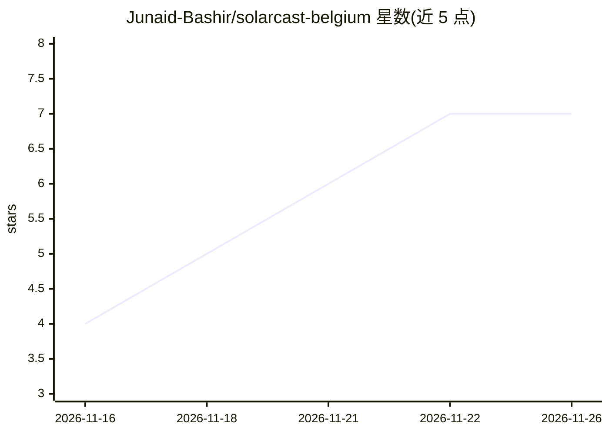

# Junaid-Bashir/solarcast-belgium

⭐ 7 · Python · Apache-2.0 · 推送 2026-11-16 · [GitHub](https://github.com/Junaid-Bashir/solarcast-belgium) · [官网](https://junaid-bashir.github.io/solarcast-belgium/) · 个人维护

**为能源团队统一回测比较光伏日前预测模型的工具**

面向能源团队与预测研究者，提供统一回测框架比较日前光伏出力预测模型：统一数据、时界、信息可用性与指标，消除不同模型排名口径不一致问题。机制包括滚动 origin 回测、历史 NWP vintage 选择、common-support MAE/RMSE/技能分与失败 origin 记账；内置持久性基线、LightGBM 与 t0/Chronos-2 零样本 TSFM 适配器。数据由用户提供，benchmark() 不抓取 PV/NWP。处于 0.1.0 研究阶段，无运营预测、模型自动选择与概率评估功能。

## 筛选速览

| 维度 | 判定 | 备注 |
|---|---|---|
| AI 角色 | `ai-ecosystem` | LLM/agent 周边工具 |
| 许可风险 | `permissive` | Apache-2.0 |
| 部署形态 | `desktop` | 安装包/桌面程序 |
| 模型依赖 | — | README 未给出锁定关系 |
| 硬件要求 | — | 无带数字的原话,不猜 |
| 安装摩擦 | `low` | 无编译、无系统依赖或容器化 |
| 成熟度 | `idea` | |

## 能力要点

- 滚动 origin 回测，显式发布时间与有界历史
- 持久性基线、LightGBM 与 t0/Chronos-2 TSFM 适配器
- common-support 指标（MAE/RMSE/偏差/技能分）与失败记账
- 离线合成快速上手，无需凭证、权重或 GFS 准备

## 适用场景

- 在相同数据与时界下比较多个光伏预测模型
- 评估新模型相对基线的技能提升
- 复现 Elia 日前光伏开发基准结果

## 场景标签

`模型评测` · 领域:评测与运维

## 证据(README 行号)

> L23: information availability and metrics differ. SolarCast provides a common framework:
> L63: |`t0`|t0-gamma TSFM|Zero-shot|None|`t0`|
> L146: **Active development / research software: 0.1.0.** The API may evolve before 1.0. Operational `forecast()`, automa

## 星数曲线

2026-11-16 4 → 2026-11-26 7（+3）

---
*卡片 v1 · prompt 1.4 · 生成 2026-11-21 · 置信度 high · 依据 README sha `7b20b37982b7` · [字段定义](../../DATASET.md)*
