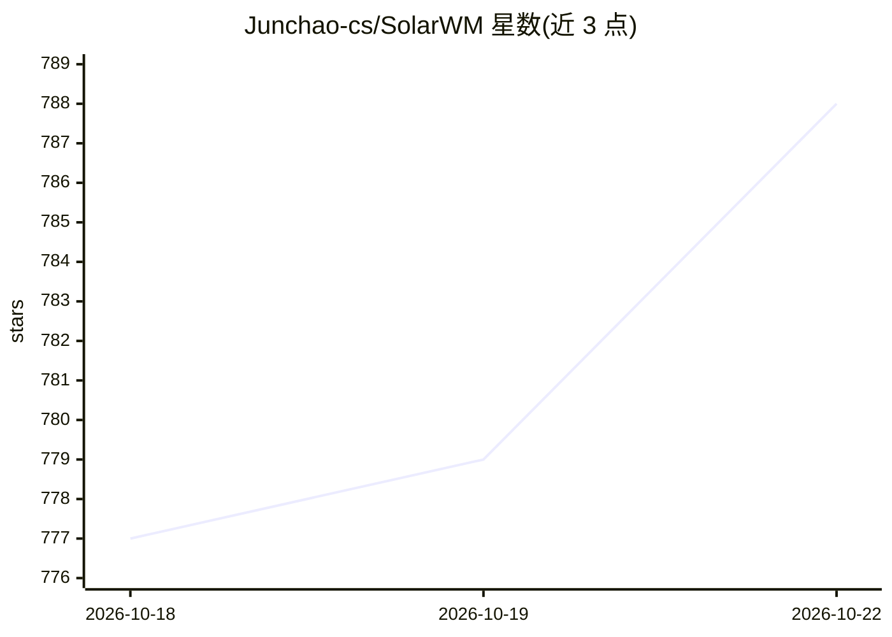

# Junchao-cs/SolarWM

⭐ 788 · Python · Apache-2.0 · 推送 2026-10-16 · [GitHub](https://github.com/Junchao-cs/SolarWM) · [官网](https://junchao-cs.github.io/SolarWM-Web/) · 组织维护

**长时程交互视频世界模型的开源数据与训练框架**

端到端构建交互式视频世界模型的框架：统一支持 Wan2.2、LTX-2.5、MiniMax-H3 三类骨干共四个 5B–33B 模型，共享数据、训练与推理接口。训练采用三阶段流程（双向适配 → teacher-forced 自回归初始化 → 分布匹配蒸馏），产出支持滑窗长时程少步交互的因果模型。配套发布 1.43M 视频（25TB）数据集、数据处理管线与模型权重，提供 solarwm CLI 统一配置解析与启动。Apache-2.0 许可。

## 筛选速览

| 维度 | 判定 | 备注 |
|---|---|---|
| AI 角色 | `ai-ecosystem` | LLM/agent 周边工具 |
| 许可风险 | `permissive` | Apache-2.0 |
| 部署形态 | `library` | 以包/库形式分发 |
| 模型依赖 | — | README 未给出锁定关系 |
| 硬件要求 | — | 无带数字的原话,不猜 |
| 安装摩擦 | `low` | 无编译、无系统依赖或容器化 |
| 成熟度 | — | 结构信号不足 |

## 能力要点

- 统一框架支持 Wan2.2/LTX-2.5/MiniMax-H3 四个 5B–33B 模型
- 三阶段训练配方（双向适配、TF-AnyFlow、SGF-DMD）
- 发布 1.43M 条视频（25TB）开放数据集与处理管线
- solarwm CLI：配置解析、训练/推理/预编码统一命令，启动前写出 manifest

## 适用场景

- 在多种视频骨干上训练相机控制的长时程自回归世界模型
- 获取带度量相机几何、字幕与质量元数据的开放视频数据集
- 对结构视频做少步条件化视频渲染（SolarRenderer 集成）

## 场景标签

`视频生成` `模型训练` · 领域:内容生成

## 证据(README 行号)

> L29: We present **SolarWM**, a fully open, end-to-end framework for building
> L33: - **Four models. One codebase.** A unified framework supports **four
> L61: The staged workflow is **Stage0.5 FM → Stage1 TF-AnyFlow → Stage2 DMD via

## 星数曲线

2026-10-18 777 → 2026-10-22 788（+11）

---
*卡片 v1 · prompt 1.4 · 生成 2026-10-21 · 置信度 mid · 依据 README sha `44bb824636a6` · [字段定义](../../DATASET.md)*
