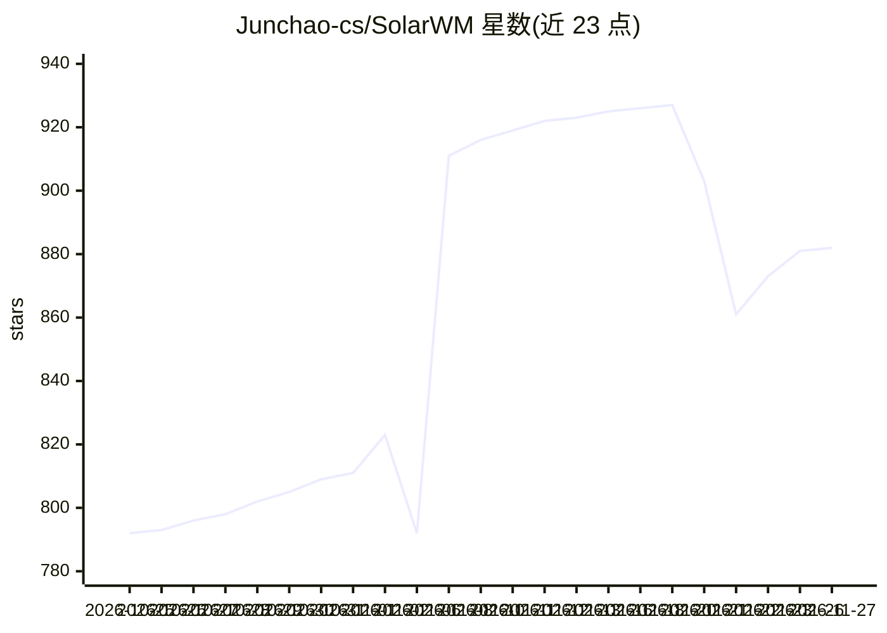

# Junchao-cs/SolarWM

⭐ 882 · Python · Apache-2.0 · 推送 2026-11-20 · [GitHub](https://github.com/Junchao-cs/SolarWM) · [官网](https://junchao-cs.github.io/SolarWM-Web/) · 组织维护

**交互式视频世界模型开源框架：数据+训练+实时部署**

Solar 是交互式世界模型与生成式视频渲染的开源框架，包含 SolarWM 与 SolarRenderer 两部分：SolarWM 提供长时程相机可控视频世界模型的开源数据（143 万视频片段、25 TB）与可扩展训练流程，支持 Wan2.2、LTX-2.5、MiniMax-H3 四种 5B–33B 骨干模型，并含 H3 实时交互与流式 VAE 解码；SolarRenderer 在 MiniMax-H3 上做四步结构条件视频渲染。从仓库根目录 pip 安装，文档提供训练、推理与部署指南。

## 筛选速览

| 维度 | 判定 | 备注 |
|---|---|---|
| AI 角色 | `ai-native` | 本体是模型或模型工具 |
| 许可风险 | `permissive` | Apache-2.0 |
| 部署形态 | `library` | 以包/库形式分发 |
| 模型依赖 | — | README 未给出锁定关系 |
| 硬件要求 | — | 无带数字的原话,不猜 |
| 安装摩擦 | `medium` | 含编译或系统依赖之一 |
| 成熟度 | — | 结构信号不足 |

## 能力要点

- 开源 1.43M 视频片段（25 TB、14 来源）数据集与数据处理管线
- 支持 Wan2.2、LTX-2.5、MiniMax-H3 四种 5B–33B 模型骨干的统一训练流程
- SolarWM-H3 Realtime 支持低延迟图像+提示词的实时交互视频生成
- SolarRenderer 提供四步结构条件视频渲染，附带 208 用例泛化基准

## 适用场景

- 训练相机可控的长时程视频世界模型
- 从结构视频生成渲染视频
- 部署实时交互式场景探索演示
- 获取带相机标注与字幕的预训练视频数据

## 场景标签

`视频生成` `模型训练` `推理引擎` · 领域:内容生成

## 证据(README 行号)

> L5: **Solar** is an open framework for interactive world models, spanning open data,
> L66: - **SolarWM**: Open data and scalable training for **long-horizon, camera-controlled video world models**, backed b

## 星数曲线

2026-10-25 792 → 2026-11-27 882（+90）

---
*卡片 v1 · prompt 1.4 · 生成 2026-11-25 · 置信度 high · 依据 README sha `ef313802d668` · [字段定义](../../DATASET.md)*
