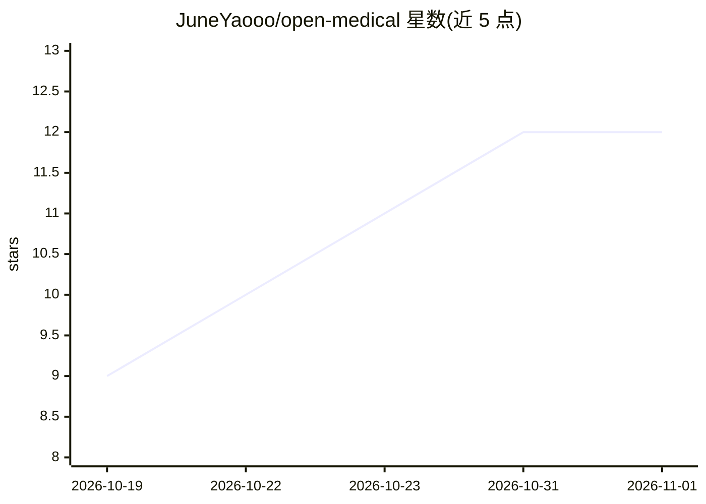

# JuneYaooo/open-medical

⭐ 12 · JavaScript · MIT · 推送 2026-10-31 · [GitHub](https://github.com/JuneYaooo/open-medical) · 个人维护 · 中文 README

**面向医生的开源本地优先桌面 Agent，管理患者、知识与任务**

运行于 macOS / Windows 的 Electron 桌面应用（需 Node.js ≥ 22.18）：通过自然语言管理患者档案、病历整理、检验导入、随访计划、任务模板（15 类临床写作模板）、知识库与文献检索（PubMed / Europe PMC）、病例库、临床试验入组初筛、DRG 测算等。资料存储在本机 SQLite，模型按需连接（本地 Ollama / vLLM 或 DeepSeek、OpenAI、Anthropic、OpenRouter 等 API），AI 结果以待确认提案呈现并需医生复核；临床有效性尚未验证，未实现多人权限与 HIS/EMR 对接。

## 筛选速览

| 维度 | 判定 | 备注 |
|---|---|---|
| AI 角色 | `ai-native` | 本体是模型或模型工具 |
| 许可风险 | `permissive` | MIT |
| 部署形态 | `desktop` | 安装包/桌面程序 |
| 模型依赖 | local-ok | 支持本地模型 |
| 硬件要求 | — | 无带数字的原话,不猜 |
| 安装摩擦 | `low` | 无编译、无系统依赖或容器化 |
| 成熟度 | `idea` | |

## 能力要点

- 患者、检验、随访、知识库、病例库与文献检索的一站式管理
- 15 类临床写作任务模板（病历草稿、出院小结、CARE 个案报告等）
- 本地 SQLite 存储数据，支持本地 Ollama / vLLM 与多家云端 API 连接
- Agent 可操作浏览器、项目文件与 Skills/MCP 扩展，文件修改走提案审批

## 适用场景

- 医生在诊前整理患者档案、检验趋势与用药清单
- 生成病历草稿、出院小结等文书初稿并复核修改
- 建立个人临床知识库并做带原文溯源的检索与文献研究
- 安排随访计划、复诊提醒并登记联系结果

## 场景标签

`知识库管理` `科研工具` · 领域:知识与检索

## 证据(README 行号)

> L17: Open Medical 是面向医生的开源桌面 Agent，运行于 macOS / Windows。通过自然语言管理患者、资料、知识与任务，把病历整理、文献检索、文书准备和持续随访连接起来。我们希望它能逐步融入医生的知识积累与工作
> L19: **资料在本机积累，模型按需连接，结果由医生复核。** 支持本地 Ollama / vLLM，以及 DeepSeek、OpenAI、Anthropic、OpenRouter 和 OpenAI 兼容服务。

## 星数曲线

2026-10-19 9 → 2026-11-01 12（+3）

---
*卡片 v1 · prompt 1.4 · 生成 2026-11-01 · 置信度 high · 依据 README sha `531fafbea203` · [字段定义](../../DATASET.md)*
