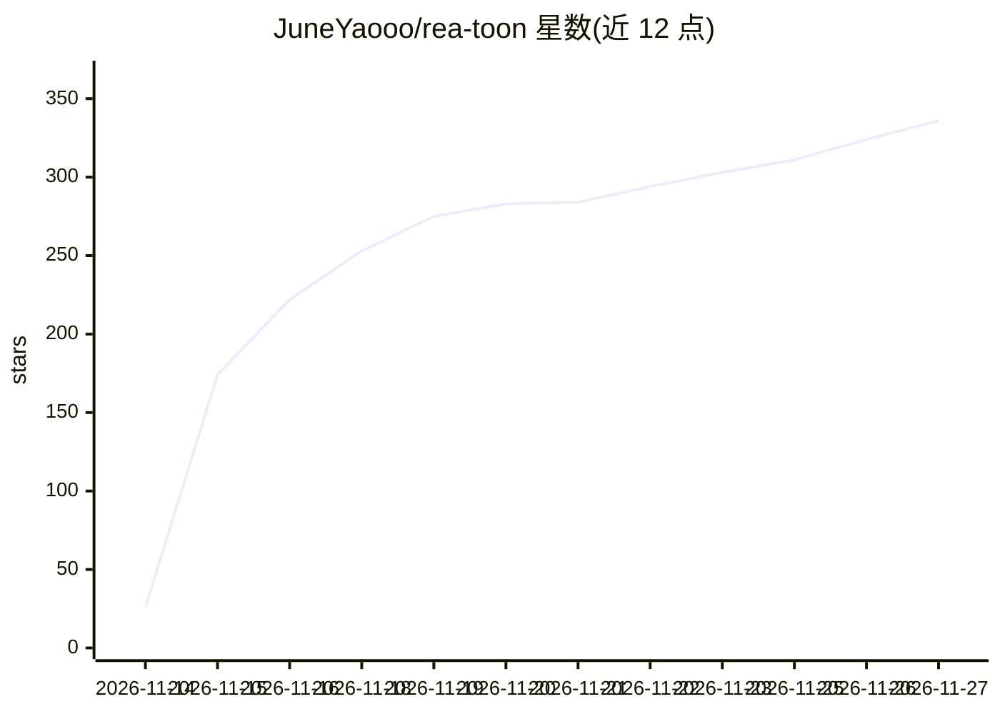

# JuneYaooo/rea-toon

⭐ 336 · Python · NOASSERTION · 推送 2026-11-22 · [GitHub](https://github.com/JuneYaooo/rea-toon) · 个人维护 · 中文 README

**用 AI agent 拆解短剧：爆火原因、剧本与分镜逐镜分析**

面向短视频/短剧学习者与创作者的 Python CLI 工具，设计为在 Claude Code、Codex 等可执行命令的 agent 中运行：输入本地视频文件或分集文件夹，agent 按内置 SKILL.md 工作流完成镜头切分、语音分离、OCR 字幕读取、台词归属、角色表与情绪节拍统计，产出三种视图（学习分析、标准剧本、分镜脚本）的 index.html 页面及供 agent 后续读取的 VIDEO.md 开放格式。要求具备视觉能力的模型；默认 agent 自答无需 API key，长剧集可配置 OpenAI 兼容 vision API 并行计费调用。许可为 PolyForm Noncommercial，商用需作者书面许可。

## 筛选速览

| 维度 | 判定 | 备注 |
|---|---|---|
| AI 角色 | `ai-native` | 本体是模型或模型工具 |
| 许可风险 | `none` | NOASSERTION |
| 部署形态 | `None` |  |
| 模型依赖 | — | README 未给出锁定关系 |
| 硬件要求 | — | 无带数字的原话,不猜 |
| 安装摩擦 | `medium` | 含编译或系统依赖之一 |
| 成熟度 | — | 结构信号不足 |

## 能力要点

- 输出 index.html 三视图（Study/Script/Shot script）与 VIDEO.md 开放格式双产物
- 每条结论附证据（镜头号、时间、台词、帧），可对照原片核验
- 情绪节拍由代码基于逐镜标签统计，非模型事后总结
- 支持单视频或整季连续分析，可中断续跑，多语言输出跟随对话语言

## 适用场景

- 分析一部短剧为什么火、可复用的叙事公式是什么
- 从已有视频反推标准剧本与逐镜分镜脚本并导出 PDF
- 把 VIDEO.md 交给 agent 后续追问剧集细节

## 场景标签

`多模态` · 领域:感知与多模态

## 证据(README 行号)

> L29: rea-toon is built for AI agents. In Claude Code, Codex or any agent that can run commands, say:
> L35: The agent installs the CLI, learns the workflow (skills/rea-toon/SKILL.md) and runs it to the end. You need ffmpeg 
> L37: **Vision is required.** The breakdown looks at every shot, so you need at least one of these: an agent that can see

## 星数曲线

2026-11-14 26 → 2026-11-27 336（+310）

---
*卡片 v1 · prompt 1.4 · 生成 2026-11-25 · 置信度 high · 依据 README sha `b1ec6f1792e5` · [字段定义](../../DATASET.md)*
