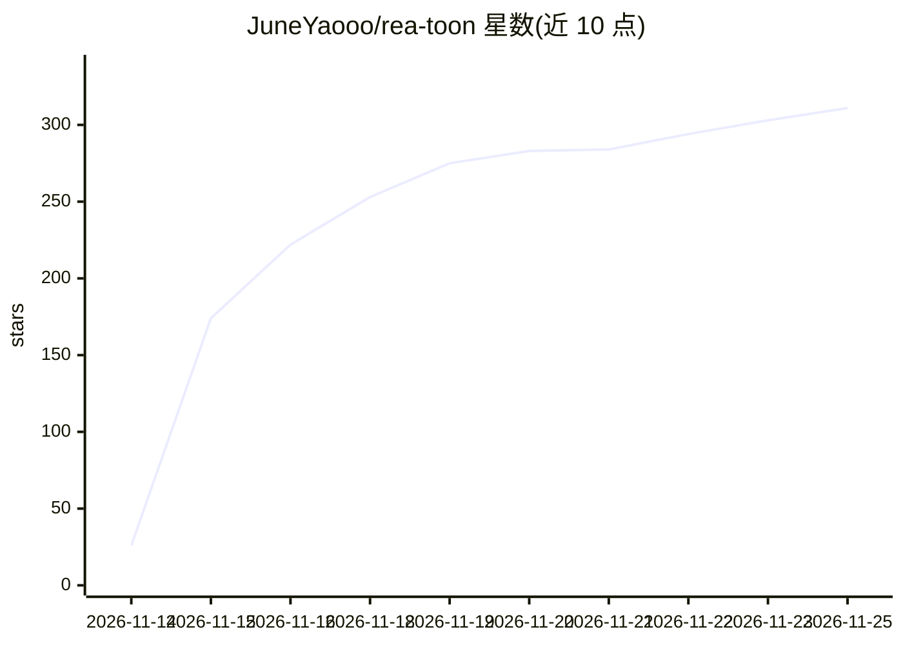

# JuneYaooo/rea-toon

⭐ 311 · Python · NOASSERTION · 推送 2026-11-22 · [GitHub](https://github.com/JuneYaooo/rea-toon) · 个人维护 · 中文 README

**用 AI 拆解短剧的 CLI 工具：为何火、剧本与逐镜拍法**

面向 AI agent（Claude Code、Codex 等）设计的命令行工具：读取本地视频文件或整季剧集文件夹，基于 rea-video 完成镜头切分与人声/音乐分离，本地 OCR（RapidOCR）读字幕，再由具备视觉能力的模型逐镜分析，产出学习报告、标准短剧剧本与逐镜脚本（含角色表、构图、台词、时长等），并可导出 PDF 与 index.html 页面。同时输出 VIDEO.md 开放格式供 agent 后续读取。限制：必须具备视觉能力，长剧集需配置 OpenAI 兼容视觉模型 API（按调用计费，每集约 30 次视觉调用），许可证禁止商用。

## 筛选速览

| 维度 | 判定 | 备注 |
|---|---|---|
| AI 角色 | `ai-native` | 本体是模型或模型工具 |
| 许可风险 | `none` | NOASSERTION |
| 部署形态 | `None` |  |
| 模型依赖 | — | README 未给出锁定关系 |
| 硬件要求 | — | 无带数字的原话,不猜 |
| 安装摩擦 | `medium` | 含编译或系统依赖之一 |
| 成熟度 | — | 结构信号不足 |

## 能力要点

- 拆解结果输出为 VIDEO.md 开放格式，供 agent 分层读取
- 支持真人剧、AI 剧条、2D/3D 动画、动态条漫、解说等多种格式的针对性分析
- 情绪节拍由代码从每镜情绪标签统计，而非模型事后概括
- 每次调用附带证据（镜号、时间、台词、帧），可修正后重建页面

## 适用场景

- 我想弄清一部爆款短剧为什么火、能借鉴什么
- 把短剧转成标准剧本和逐镜脚本用于学习或研究
- 拆解整季剧集并得到跨集结构、套路与付费卡点分析

## 场景标签

`多模态` `科研工具` · 领域:学习与行业

## 证据(README 行号)

> L3: Break down any short drama with AI: animated comic dramas, live-action and AI-generated.
> L5: A tool for learning from short dramas: why one went viral, how the script is written, how every shot is filmed.
> L29: rea-toon is built for AI agents. In Claude Code, Codex or any agent that can run commands, say:

## 星数曲线

2026-11-14 26 → 2026-11-25 311（+285）

---
*卡片 v1 · prompt 1.4 · 生成 2026-11-17 · 置信度 high · 依据 README sha `8df833700ad5` · [字段定义](../../DATASET.md)*
