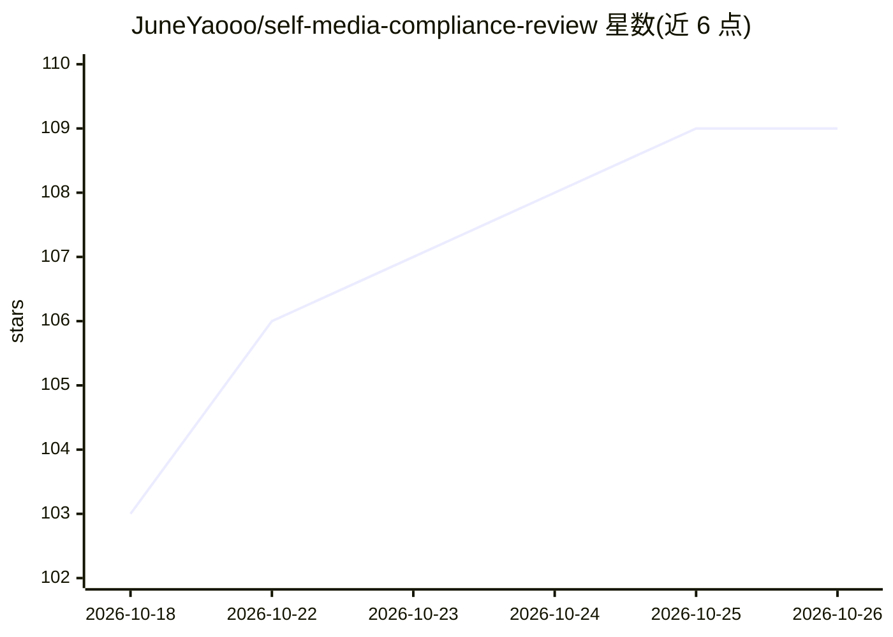

# JuneYaooo/self-media-compliance-review

⭐ 109 · Python · MIT · 推送 2026-10-12 · [GitHub](https://github.com/JuneYaooo/self-media-compliance-review) · 个人维护 · 中文 README

**自媒体视频发布前违规风险审核 Skill：输出五级风险报告**

装进支持 Skills 的 agent（Claude Code / Codex / OpenClaw / Hermes 等）使用的审核技能：按目标平台读取仓库自带的规则与案例文件，检查视频画面、声音、字幕、封面、评论引导、带货信息、资质与引流，输出 Pass/Low/Medium/High/Blocker 五级报告和修改建议。覆盖微信视频号、公众号、抖音、快手、B站、小红书及千川低质素材等专项。本地视频分析由 tools/analyze_video.py 生成带时间点的证据包（依赖 ffmpeg/ffprobe，Whisper 转写可选）；默认只做本地静态检索不联网，实时平台检索需用户明确要求并按档位启用通道。不提供法律结论，不能替代人工法务审核。

## 筛选速览

| 维度 | 判定 | 备注 |
|---|---|---|
| AI 角色 | `ai-native` | 本体是模型或模型工具 |
| 许可风险 | `permissive` | MIT |
| 部署形态 | `None` |  |
| 模型依赖 | — | README 未给出锁定关系 |
| 硬件要求 | — | 无带数字的原话,不猜 |
| 安装摩擦 | `medium` | 含编译或系统依赖之一 |
| 成熟度 | — | 结构信号不足 |

## 能力要点

- 按 6+ 平台规则文件做结构化发布前审核，输出 Pass→Blocker 五级风险分级
- tools/analyze_video.py 提取帧/音轨/字幕生成带时间点的本地视频证据包
- 默认本地静态检索（不联网、不耗 API 额度），实时检索需用户明确要求并按 ①-⑤ 档位顺位启用
- 提供三个版本化 JSON Schema（审核报告/商品一致性/视频证据清单），支持接入飞书审批等流程

## 适用场景

- 短视频交付前审核标题、封面、字幕、口播与发布文案
- 带货视频检查商品三一致、功效声明、资质与千川低质素材
- 账号限流/封号后按案例库排查原因并准备申诉材料

## 场景标签

 · 领域:内容合规/自媒体风控

## 证据(README 行号)

> L3: **自媒体视频发布前的违规风险审核 Skill。**
> L5: 适用于 Claude Code / Codex / OpenClaw / Hermes 等支持 Skills 的 agent。把它装进 agent 后，可以在短视频、切片、封面、标题、字幕、口播、商品链接和发布文案交付前，按本仓库整
> L22: - **风险分级**：输出 `Pass` / `Low` / `Medium` / `High` / `Blocker`。

## 星数曲线

2026-10-18 103 → 2026-10-26 109（+6）

---
*卡片 v1 · prompt 1.4 · 生成 2026-10-23 · 置信度 high · 依据 README sha `bdb06446ed4c` · [字段定义](../../DATASET.md)*
