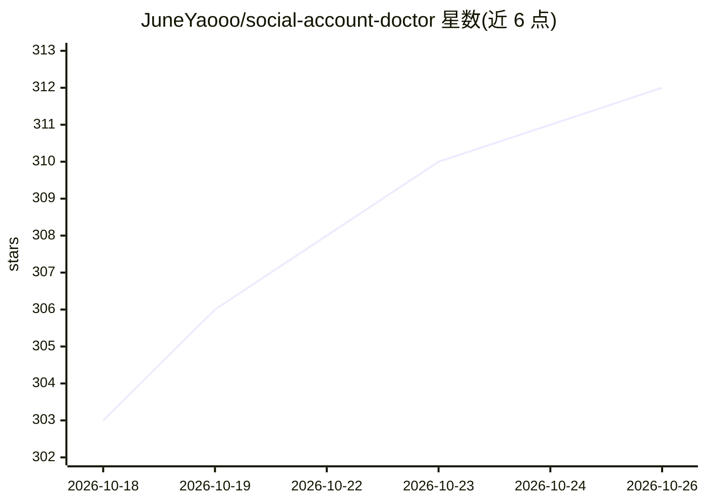

# JuneYaooo/social-account-doctor

⭐ 312 · Python · MIT · 推送 2026-09-19 · [GitHub](https://github.com/JuneYaooo/social-account-doctor) · 个人维护 · 中文 README

**给自媒体运营者的账号体检与爆款拆解 agent 技能**

面向小红书/抖音/快手/视频号/B站运营者，以 Claude Code 等 agent 技能形式提供账号诊断、爆款拆解与仿写初稿生成：输入账号或视频链接，扫描同赛道找对标、逐项诊断封面/标题/结构问题，结合 3-5 条同类对标输出差距分析；带货模式下读取商品详情/SKU/资质材料生成事实卡、口播脚本与分镜。平台数据来源分四级（agent 浏览器工具/opencli/TikHub API/扫码登录），需自行配置多模态大模型 key；内置平台阈值为经验值非官方数据。也提供可独立调用的 Python CLI 脚本。

## 筛选速览

| 维度 | 判定 | 备注 |
|---|---|---|
| AI 角色 | `ai-native` | 本体是模型或模型工具 |
| 许可风险 | `permissive` | MIT |
| 部署形态 | `library` | 以包/库形式分发 |
| 模型依赖 | locked-api |  |
| 硬件要求 | — | 无带数字的原话,不猜 |
| 安装摩擦 | `medium` | 含编译或系统依赖之一 |
| 成熟度 | — | 结构信号不足 |

## 能力要点

- 账号诊断+爆款六维拆解+可粘贴仿写初稿
- 带货工作流：商品事实卡+三档脚本+分镜，事实仅来自用户上传材料
- 四级平台数据源优先级（agent 浏览器>opencli>TikHub>mc 扫码登录）
- 统一输出树：报告/钩子库/缓存/媒体，24 小时缓存复用

## 适用场景

- 诊断我的账号在同赛道的位置与差距
- 拆解一条爆款为什么爆并仿写
- 判断手上的素材能不能出爆款
- 给带货商品生成口播脚本和分镜

## 场景标签

`AI 写作` `数据分析` · 领域:效率与自动化

## 证据(README 行号)

> L3: > 小红书 / 抖音 / 快手 / 视频号 / B 站 自媒体的**账号体检 + 爆款拆解**工具，另含**证据驱动的带货素材审查与脚本生成**。
> L75: 1. **一个会看图 / 看视频的大模型 key + 端点** —— 推荐 Gemini 3.1 Pro,OpenAI 协议兼容的服务都行（OpenAI / SiliconFlow / Gemini 官方兼容端点 / 可信代理站）

## 星数曲线

2026-10-18 303 → 2026-10-26 312（+9）

---
*卡片 v1 · prompt 1.4 · 生成 2026-10-21 · 置信度 mid · 依据 README sha `75dbd9e0c4ec` · [字段定义](../../DATASET.md)*
