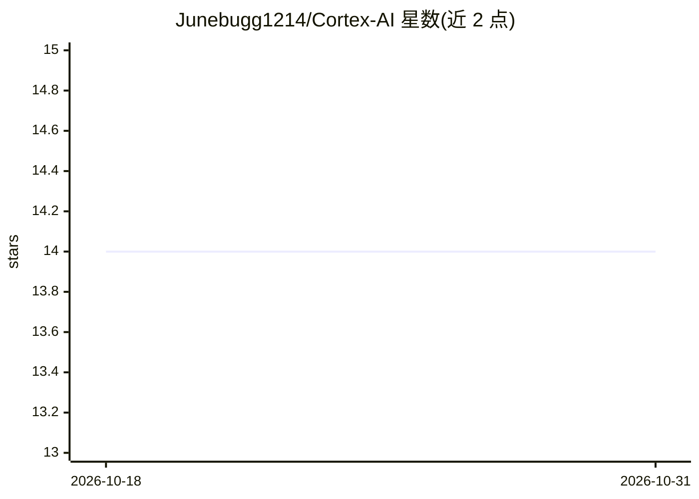

# Junebugg1214/Cortex-AI

⭐ 14 · Python · MIT · 推送 2026-05-16 · [GitHub](https://github.com/Junebugg1214/Cortex-AI) · [官网](http://cortex-ore.com/) · 个人维护

**给 AI agent 用的本地版本化记忆层，Git 式提交与 MCP 服务**

Cortex 是面向 AI agent 的本地记忆层：在磁盘上存储用户拥有的知识图谱，提供 Git 风格的 commit/branch/merge/blame、基于来源的撤回（retraction）与受众披露策略，并内置 MCP server 供任意 agent 读取。记忆可通过 cortex mind mount/sync 写入 Claude Code、Codex、Cursor 等本地工具的指令文件（多数为只写，Claude/Notion/SystemPrompt 支持往返拉取）。默认抽取为本地规则式，模型抽取为可选且使用用户自己的 provider key；PDF 需预先转换为支持的文本/JSON 格式。远端目前仅支持本地文件系统路径。

## 筛选速览

| 维度 | 判定 | 备注 |
|---|---|---|
| AI 角色 | `ai-ecosystem` | LLM/agent 周边工具 |
| 许可风险 | `permissive` | MIT |
| 部署形态 | `library` | 以包/库形式分发 |
| 模型依赖 | — | README 未给出锁定关系 |
| 硬件要求 | — | 无带数字的原话,不猜 |
| 安装摩擦 | `low` | 无编译、无系统依赖或容器化 |
| 成熟度 | — | 结构信号不足 |

## 能力要点

- Git 风格的记忆版本化：commit/branch/merge/diff，Merkle 链版本 id
- 来源溯源与 source-backed retraction（先 dry-run 再确认）
- MCP server、本地 REST 与 SDK 三种集成方式，无 Cortex 云与 API key
- 去重基于词法标签相似度+图邻居重叠，不使用 embeddings

## 适用场景

- 为 Claude Code/Codex/Cursor 等 agent 维护跨工具共享的持久记忆
- 对团队知识/策略文件做版本化、可审查、可撤回的记忆管理
- 本地优先地管理 agent 上下文，不依赖第三方云服务

## 场景标签

`Agent 记忆` `知识图谱` · 领域:Agent 开发

## 证据(README 行号)

> L3: **Git for AI memory. Local-first, MCP-native.**
> L5: Cortex is a local memory layer for AI agents. It gives you a user-owned graph on disk with Git-like commits, branche
> L7: No Cortex cloud. No Cortex API key. Your agent keeps using its own LLM; Cortex is just where the memory lives. Optio

## 星数曲线

2026-10-18 14 → 2026-10-31 14（+0）

---
*卡片 v1 · prompt 1.4 · 生成 2026-10-31 · 置信度 high · 依据 README sha `e4e6ba5230ad` · [字段定义](../../DATASET.md)*
