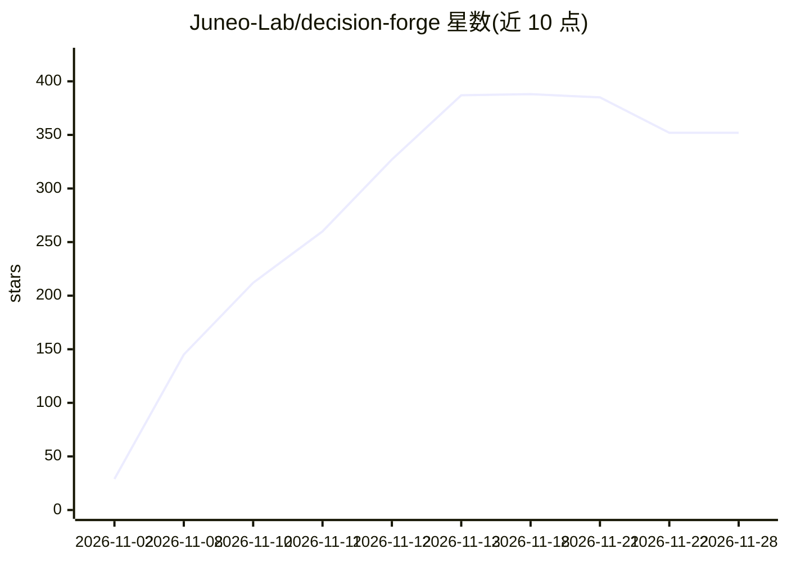

# Juneo-Lab/decision-forge

⭐ 352 · Python · Apache-2.0 · 推送 2026-11-22 · [GitHub](https://github.com/Juneo-Lab/decision-forge) · [官网](https://juneo-lab.github.io/decision-forge/) · 组织维护 · 中文 README

**把组织政策编译成可验证决策训练数据的 Python 管线**

Decision Forge 读取手册、SOP、审批规则等组织文档，编译为带来源引证与哈希的规则规范，经业务评审后在本地离线生成四类决策面（分配工作/共享信息/执行/评估结果）的场景与标签；标签由确定性策略解释器重算，支持家族隔离防泄漏切分、去重与配额报告，并导出四种训练格式。评审后的规范可无需模型凭据本地构建；文档编译与模型辅助合成需显式指定的模型端点。需 Python 3.11+ 与 uv。

## 筛选速览

| 维度 | 判定 | 备注 |
|---|---|---|
| AI 角色 | `ai-ecosystem` | LLM/agent 周边工具 |
| 许可风险 | `permissive` | Apache-2.0 |
| 部署形态 | `library` | 以包/库形式分发 |
| 模型依赖 | — | README 未给出锁定关系 |
| 硬件要求 | — | 无带数字的原话,不猜 |
| 安装摩擦 | `low` | 无编译、无系统依赖或容器化 |
| 成熟度 | `idea` | |

## 能力要点

- 确定性策略解释器重算每个标签，标签可溯源到规则与原文引证
- 离线数据路径：评审后规则→场景→标签→导出，无需 API key 或模型下载
- 家族隔离切分与 split 锁，跨版本保持训练/留出划分
- 支持 Text/Markdown/JSON/YAML/PDF/DOCX/XLSX/PPTX/HTML/CSV/TSV 及本地 OCR 摄入

## 适用场景

- 把公司内部审批规则变成可审计的决策模型训练集
- 为 agent 权限决策（退款、文件共享、任务分配）构造带出处的监督数据
- 训练前检查数据集分布缺口与跨切分重复

## 场景标签

`微调` `文档解析` · 领域:知识与检索

## 证据(README 行号)

> L89: The data pipeline evaluates scenarios against the approved rules and exports decision examples with
> L96: > Document compilation and model-assisted synthesis use an explicitly selected model endpoint.

## 星数曲线

2026-11-02 29 → 2026-11-28 352（+323）

---
*卡片 v1 · prompt 1.4 · 生成 2026-11-25 · 置信度 mid · 依据 README sha `c121d67229fc` · [字段定义](../../DATASET.md)*
