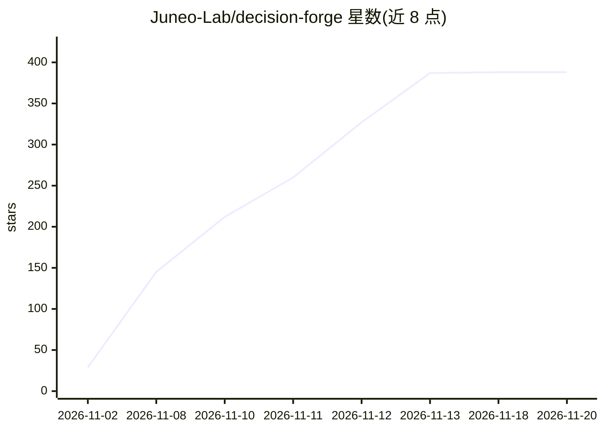

# Juneo-Lab/decision-forge

⭐ 388 · Python · Apache-2.0 · 推送 2026-11-16 · [GitHub](https://github.com/Juneo-Lab/decision-forge) · [官网](https://juneo-lab.github.io/decision-forge/) · 组织维护 · 中文 README

**把组织政策文档编译为可验证的决策训练数据**

面向需要训练符合自身规则的 AI agent 的组织与开发者：读取手册、SOP、工单等工作流文档，经模型端点起草规则（带来源引文）并经业务评审，随后全程离线生成场景、用确定性策略解释器回放标注、按家族隔离去重，导出四种训练格式。每个标签可追溯到规则与原文出处。文档编译与模型辅助合成需显式选择模型端点，评审后路径无需 API key。项目处于 v0.3.2 alpha。

## 筛选速览

| 维度 | 判定 | 备注 |
|---|---|---|
| AI 角色 | `ai-ecosystem` | LLM/agent 周边工具 |
| 许可风险 | `permissive` | Apache-2.0 |
| 部署形态 | `library` | 以包/库形式分发 |
| 模型依赖 | — | README 未给出锁定关系 |
| 硬件要求 | — | 无带数字的原话,不猜 |
| 安装摩擦 | `low` | 无编译、无系统依赖或容器化 |
| 成熟度 | `idea` | |

## 能力要点

- 文档→规则→场景→已验证标签→训练导出的离线数据管线
- 确定性策略解释器回放计算标签，来源引文经原文校验
- 家族级数据集切分隔离与切分锁文件
- 支持多种文档格式（PDF/DOCX/XLSX/PPTX/HTML/OCR 等）

## 适用场景

- 把组织手册与审批规则转成可审计的微调数据
- 为决策模型构建带来源溯源的监督数据
- 不同组织各自编译策略并对比决策差异

## 场景标签

`微调` `文档解析` · 领域:知识与检索

## 证据(README 行号)

> L63: **Decision Forge turns that judgment into data.** It compiles an organization's own documents into
> L89: The data pipeline evaluates scenarios against the approved rules and exports decision examples with
> L103: |**Trains real models**|Laplace-1 is trained entirely on Decision Forge data and is best or tied for best on 7 of 

## 星数曲线

2026-11-02 29 → 2026-11-20 388（+359）

---
*卡片 v1 · prompt 1.4 · 生成 2026-11-17 · 置信度 mid · 依据 README sha `4d57ce946b7d` · [字段定义](../../DATASET.md)*
