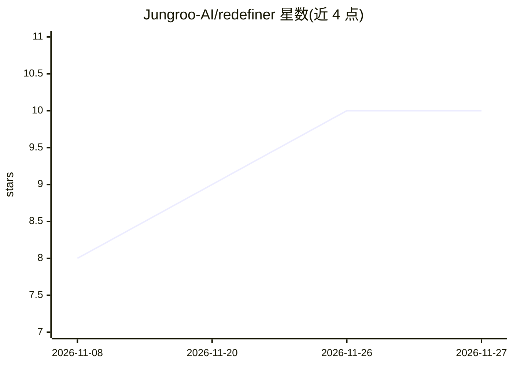

# Jungroo-AI/redefiner

⭐ 10 · Python · Apache-2.0 · 推送 2026-11-25 · [GitHub](https://github.com/Jungroo-AI/redefiner) · [官网](https://jungroo.com/redefiner/) · 组织维护

**本地 CPU 运行的 0.8B 模型：按英文规则书抽取自定义实体**

ReDefiNER 是 Jungroo AI Labs 发布的 0.8B 非生成式命名实体抽取模型：用户用纯英文 rulebook 定义实体类型与规则，模型在文本中标记精确字符 span 并输出类型与置信度，不改写文本；修改规则即可改变抽取行为，无需重新训练。支持 extract（查找并标注 span）与 label（标注已有 span）两种模式，提供 Python API 与本地 HTTP 服务器。在 CPU 上运行（峰值内存约 2–2.6 GB），下载后可离线工作，仅支持英文，默认 span 上限 16 tokens。

## 筛选速览

| 维度 | 判定 | 备注 |
|---|---|---|
| AI 角色 | `ai-native` | 本体是模型或模型工具 |
| 许可风险 | `permissive` | Apache-2.0 |
| 部署形态 | `library` | 以包/库形式分发 |
| 模型依赖 | — | README 未给出锁定关系 |
| 硬件要求 | `cpu-ok` | |
| 安装摩擦 | `medium` | 含编译或系统依赖之一 |
| 成熟度 | — | 结构信号不足 |

## 能力要点

- 0.8B 参数、单个 0.77 GB int8 权重文件，普通 CPU 即可运行
- 纯英文 rulebook 控制实体类型，改规则不改训练
- 非生成式：返回精确字符 span 及置信度，输出确定 span 而非新文本
- 提供 Python 接口与本地 HTTP 服务器，可完全离线运行

## 适用场景

- 银行、医院、政府等不能外发数据的团队在自有服务器上抽取 PII
- 为工单文本按自定义类型（账号、邮箱、电话）标注敏感信息
- 产品团队从支持工单中提取版本、设备、错误码等实体
- 对已有 span 做类型标注（label mode）

## 场景标签

`文档解析` · 领域:知识与检索

## 证据(README 行号)

> L5: A 0.8B model that extracts and labels exact spans using your plain-English rulebook. It is non-generative: it marks 
> L44: it finds, you edit the rulebook; nothing is retrained. It runs on an ordinary CPU, with no GPU and no per-use fees,
> L54: |Does|Extract mode finds and labels spans; label mode types spans you supply. English text|

## 星数曲线

2026-11-08 8 → 2026-11-27 10（+2）

---
*卡片 v1 · prompt 1.4 · 生成 2026-11-20 · 置信度 high · 依据 README sha `79f133799b15` · [字段定义](../../DATASET.md)*
