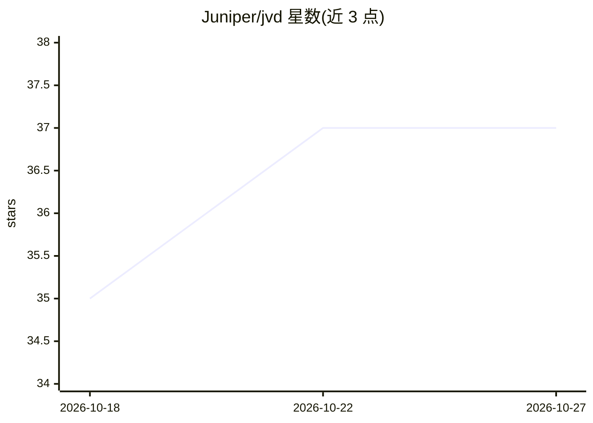

# Juniper/jvd

⭐ 37 · TypeScript · Apache-2.0 · 推送 2026-10-26 · [GitHub](https://github.com/Juniper/jvd) · [官网](https://juniper.github.io/jvd/portal/) · 组织维护

**Juniper 网络经验证设计库：配置加交互门户与 BYOAI 助手**

HPE Juniper 官方维护的经验证网络设计（JVD）仓库：按分支、园区、数据中心与 AI 集群、安全、企业 WAN、服务商等域组织，每个 JVD 含硬件表、配置索引（conf/set/apstra）与 Junos/Junos EVO 配对 snip 库。JVD Portal 将仓库转为可检索目录，提供 snip 库、BYOAI 配置/设计助手（带 grounding 护栏，一键进入 ChatGPT/Claude/VS Code）、开发中的服务配置生成器与规划中的 MCP Server。Apache 2.0 许可。

## 筛选速览

| 维度 | 判定 | 备注 |
|---|---|---|
| AI 角色 | `ai-enhanced` | 去掉 AI 部分产品仍成立 |
| 许可风险 | `permissive` | Apache-2.0 |
| 部署形态 | `None` |  |
| 模型依赖 | — | README 未给出锁定关系 |
| 硬件要求 | — | 无带数字的原话,不猜 |
| 安装摩擦 | `low` | 无编译、无系统依赖或容器化 |
| 成熟度 | `idea` | |

## 能力要点

- 按 6 个网络域组织的经验证设计与配置树
- 变量驱动、结构化头的 Junos/Junos EVO snip 片段库
- BYOAI 配置/设计助手，护栏约束 AI 基于已验证 snips 与文档
- Service Config Generator（开发中）与 JVD MCP Server（规划中）

## 适用场景

- 网络工程师按经验证蓝图设计部署分支/园区/数据中心网络
- 查找并拼装 Junos 配置片段
- 借助 AI 助手基于已验证设计生成配置

## 场景标签

`代码生成` · 领域:编码与开发

## 证据(README 行号)

> L78: - **BYOAI — Bring Your Own AI**
> L80:  grounded in the validated snips and docs. One click into ChatGPT, Claude, or VS Code.

## 星数曲线

2026-10-18 35 → 2026-10-27 37（+2）

---
*卡片 v1 · prompt 1.4 · 生成 2026-10-25 · 置信度 high · 依据 README sha `96333aece040` · [字段定义](../../DATASET.md)*
