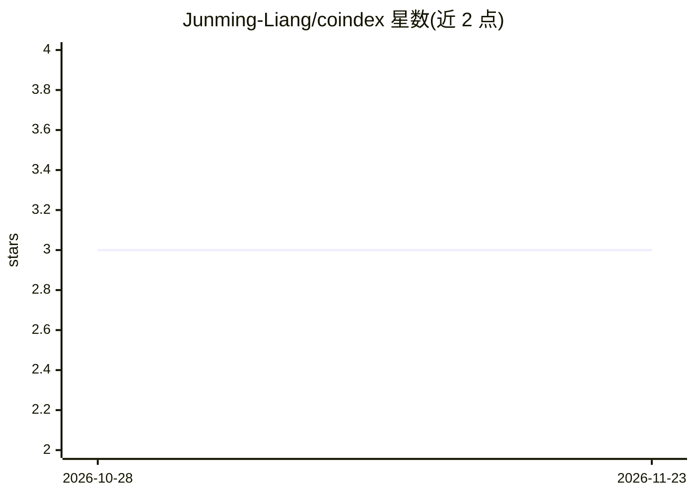

# Junming-Liang/coindex

⭐ 3 · Python · MIT · 推送 2026-11-02 · [GitHub](https://github.com/Junming-Liang/coindex) · 个人维护 · 中文 README

**帮开发者汇总多机器 Codex 会话的 macOS/Linux 跟进清单应用**

coindex 读取本机及可选 SSH 机器上的 Codex 会话记录，通过调用用户自己的 Codex CLI（默认 gpt-6-luna/max）分析每个对话中的用户目标、进度与未处理事项，整理为统一的跟进清单，并提供一键将目标、进度与下一步发回原对话的催办功能。以 macOS SwiftUI 应用与 Linux Tkinter 桌面版发布，后端仅用 Python 标准库。限制：自动分析不核实 CI/评测等实时结果，远程催办依赖远程共享 Codex 服务与桌面 IPC；macOS 构建未经 Developer ID 签名与公证。

## 筛选速览

| 维度 | 判定 | 备注 |
|---|---|---|
| AI 角色 | `ai-enhanced` | 去掉 AI 部分产品仍成立 |
| 许可风险 | `permissive` | MIT |
| 部署形态 | `desktop` | 安装包/桌面程序 |
| 模型依赖 | — | README 未给出锁定关系 |
| 硬件要求 | — | 无带数字的原话,不猜 |
| 安装摩擦 | `low` | 无编译、无系统依赖或容器化 |
| 成熟度 | — | 结构信号不足 |

## 能力要点

- 自动发现并增量读取本机与 SSH 机器上的 Codex 会话
- 整理 Agent 经用户自己的 Codex CLI 生成结构化跟进条目
- 一键催办将目标、进度与下一步发回原 Codex 对话
- 本地 SQLite 存储，采集遮蔽 token/密码/私钥/JWT

## 适用场景

- 多台机器上开多个 Codex 会话后找回各任务的目标与进度
- 会话完成后提醒自己验收与推进下一步
- 把分散的待办整理成阶段性工作总结

## 场景标签

 · 领域:开发者工具/任务管理

## 证据(README 行号)

> L18: **coindex 用一个整理 Agent，帮你记住交给其他 Agent 的工作。** 它持续阅读本机和你添加的 SSH 机器上的 Codex 会话，找出每个对话里的用户目标，把**当初要做什么、现在做到哪里、接下来该做什么、原对
> L50: 整理 Agent 通过你自己的 Codex CLI 和模型工作，默认 `gpt-6-luna` / `max`，可在设置中调整。它根据已有记录给出结构化判断，负责生成和更新跟进清单；原来的执行 Agent 继续留在各自 Codex

## 星数曲线

2026-10-28 3 → 2026-11-23 3（+0）

---
*卡片 v1 · prompt 1.4 · 生成 2026-11-22 · 置信度 mid · 依据 README sha `f484bf3a2960` · [字段定义](../../DATASET.md)*
