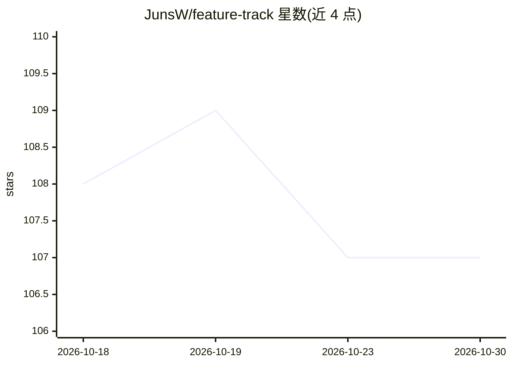

# JunsW/feature-track

⭐ 107 · Python · MIT · 推送 2026-07-16 · [GitHub](https://github.com/JunsW/feature-track) · 个人维护

**给 AI 编程 agent 的仓库内共享记忆层：Markdown 特性索引与轨道文件**

以 docs/features/ 目录下的 Markdown 文件为载体的仓库级记忆层：为每个长期特性维护一个 track 文件（当前状态、事实来源文档链接、决策、风险、近期变更）并附全局索引，供 Codex、Claude Code 等 AI 编程工具在会话间共享特性上下文。提供 validate 命令校验索引漂移、必需段落与失效链接；附带无依赖 Python CLI、Codex/Claude Code 插件与可移植 Agent Skills 包。定位为轻量记忆层，非完整 spec-driven 开发框架；当前为 v0.1.0 首个公开版本。

## 筛选速览

| 维度 | 判定 | 备注 |
|---|---|---|
| AI 角色 | `ai-ecosystem` | LLM/agent 周边工具 |
| 许可风险 | `permissive` | MIT |
| 部署形态 | `library` | 以包/库形式分发 |
| 模型依赖 | — | README 未给出锁定关系 |
| 硬件要求 | — | 无带数字的原话,不猜 |
| 安装摩擦 | `low` | 无编译、无系统依赖或容器化 |
| 成熟度 | — | 结构信号不足 |

## 能力要点

- 每个特性一个 Markdown track 文件 + 全局索引，存放于仓库内 docs/features/
- validate 命令校验索引漂移、必需段落与失效本地链接
- 提供 Codex 插件、Claude Code 插件与可移植 Agent Skills 包三种安装形态
- 无依赖的 Python CLI（init/add/validate/install）

## 适用场景

- 让多个 AI 编程工具共享同一份特性上下文，避免换工具即失忆
- 棕地项目以链接既有 PRD/API 文档方式低成本接入
- 在 CI 中用 --strict 漂移检查防止过期上下文扩散

## 场景标签

`Agent 记忆` · 领域:Agent 开发

## 证据(README 行号)

> L6: Lightweight, repo-native shared memory for AI coding agents.
> L101: At the start of work, an agent reads `docs/features/README.md`, opens the relevant feature track, and follows the 

## 星数曲线

2026-10-18 108 → 2026-10-30 107（-1）

---
*卡片 v1 · prompt 1.4 · 生成 2026-10-23 · 置信度 high · 依据 README sha `ef16a9f00439` · [字段定义](../../DATASET.md)*
