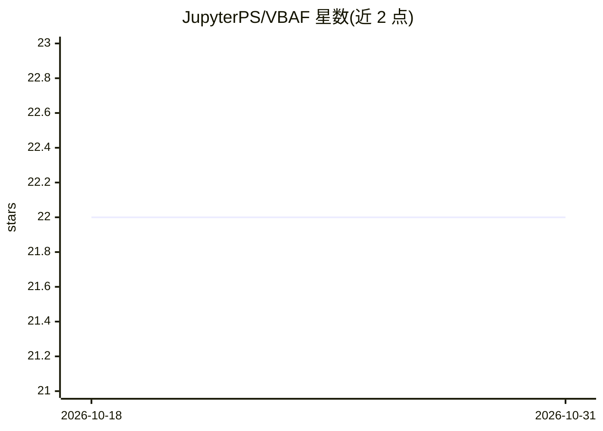

# JupyterPS/VBAF

⭐ 22 · PowerShell · MIT · 推送 2026-10-17 · [GitHub](https://github.com/JupyterPS/VBAF) · 组织维护

**纯 PowerShell 编写的教学用 AI 与强化学习框架**

面向学习者的动手型 AI 教学框架，全部代码以 PowerShell 5.1 编写，不依赖 Python、Jupyter 或云服务。核心模块从零实现神经网络、反向传播、Q-learning、DQN、PPO、A3C，并包含监督学习模块（回归、决策树、聚类、AutoML、SHAP/LIME 可解释性）与实时可视化仪表盘。另提供 26 个企业自动化支柱（DQN agent 解决 IT 运维问题，默认模拟环境）与配套教学材料（4 周课程大纲、119 步学习路径、考试题）。通过 PowerShell Gallery 安装，要求 Windows 10/11。

## 筛选速览

| 维度 | 判定 | 备注 |
|---|---|---|
| AI 角色 | `ai-native` | 本体是模型或模型工具 |
| 许可风险 | `permissive` | MIT |
| 部署形态 | `None` |  |
| 模型依赖 | — | README 未给出锁定关系 |
| 硬件要求 | — | 无带数字的原话,不猜 |
| 安装摩擦 | `low` | 无编译、无系统依赖或容器化 |
| 成熟度 | — | 结构信号不足 |

## 能力要点

- 从零实现 Q-learning、DQN、PPO、A3C 等强化学习算法，代码以可读性为设计目标
- 含监督学习模块：回归、决策树/随机森林、聚类、AutoML、SHAP/LIME
- 14 个企业自动化支柱：DQN agent 处理自愈、容量规划、异常检测等 IT 场景
- 配套教学工具：控制台教师、无代码实验站、4 周课程与学期计划

## 适用场景

- 在 Windows 上不装 Python 直接动手学习神经网络与强化学习原理
- 课堂教学：按课程大纲授课并让学生用 Playground 自主实验
- 逐行阅读 .ps1 源码理解算法实现

## 场景标签

`教程课程` `强化学习` · 领域:学习与行业

## 证据(README 行号)

> L17: VBAF is a **hands-on educational framework** for learning artificial intelligence and reinforcement learning concep
> L23: - How neural networks learn through backpropagation
> L120: |`VBAF.Core.AllClasses.ps1`|Neural network architecture -- layers, weights, activations, backpropagation|

## 星数曲线

2026-10-18 22 → 2026-10-31 22（+0）

---
*卡片 v1 · prompt 1.4 · 生成 2026-10-27 · 置信度 high · 依据 README sha `004f652f4691` · [字段定义](../../DATASET.md)*
