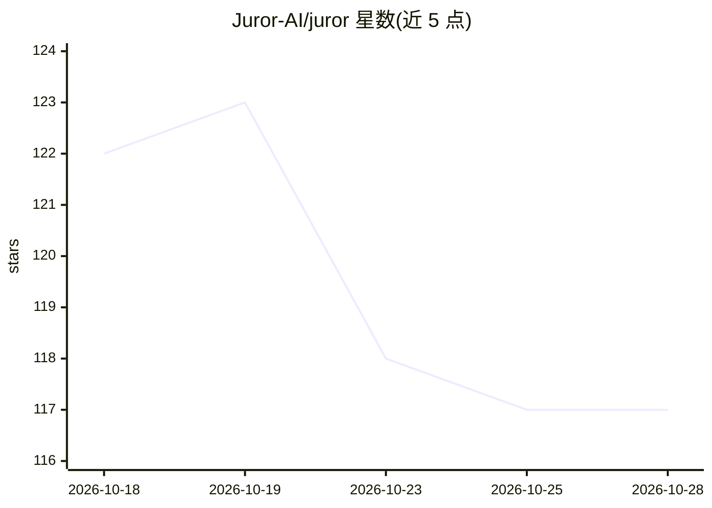

# Juror-AI/juror

⭐ 117 · TypeScript · MIT · 推送 2026-10-06 · [GitHub](https://github.com/Juror-AI/juror) · [官网](https://jays.fyi/blog/how-i-removed-greptile) · 组织维护

**多模型并行评审 PR 的 GitHub Action 与 CLI**

Juror 以 GitHub Action 或 npx CLI 形式运行：将 PR diff 分发给多个前沿模型并行评审，经锚定、分块、精确折叠、相似度+裁判去重、覆盖审计五阶段合并为单一报告，回帖到 GitHub，包含发现、合并评分与成本账单。支持 OpenAI、Fireworks、OpenRouter 等多个 provider key，可选 consensus 精度过滤模式与基于 Playwright 的合并后浏览器 QA。仓库另含可部署的 Juror Cloud 托管伴生服务（GitHub App 自动化、Stripe 计量计费）及 MCP 服务器，开源 Action 与 CLI 可独立使用。非目标：自动修复、linter、聊天界面。

## 筛选速览

| 维度 | 判定 | 备注 |
|---|---|---|
| AI 角色 | `ai-native` | 本体是模型或模型工具 |
| 许可风险 | `permissive` | MIT |
| 部署形态 | `library` | 以包/库形式分发 |
| 模型依赖 | — | README 未给出锁定关系 |
| 硬件要求 | — | 无带数字的原话,不猜 |
| 安装摩擦 | `low` | 无编译、无系统依赖或容器化 |
| 成熟度 | — | 结构信号不足 |

## 能力要点

- 多模型并行评审 PR，五阶段无损合并去重后输出单一报告
- 输出合并评分、严重度表格与每模型推理成本账单
- 可选 post-merge 浏览器 QA（Playwright、沙箱交互策略、密封认证尝试）
- CLI 可生成 SHA 固定工作流并本地评审已有 PR

## 适用场景

- 在 CI 中对每个 PR 做多模型交叉代码评审
- 减少多评审机器人重复报告与通知噪音
- 查看每次评审的真实推理成本

## 场景标签

`代码审查` · 领域:编码与开发

## 证据(README 行号)

> L5: **Juror is a GitHub Action that asks several frontier models to review each pull request in
> L179:  The diff fans out to a jury of models; their findings are anchored, blocked, merged and refereed into one comment

## 星数曲线

2026-10-18 122 → 2026-10-28 117（-5）

---
*卡片 v1 · prompt 1.4 · 生成 2026-10-23 · 置信度 high · 依据 README sha `60f471ed0b08` · [字段定义](../../DATASET.md)*
