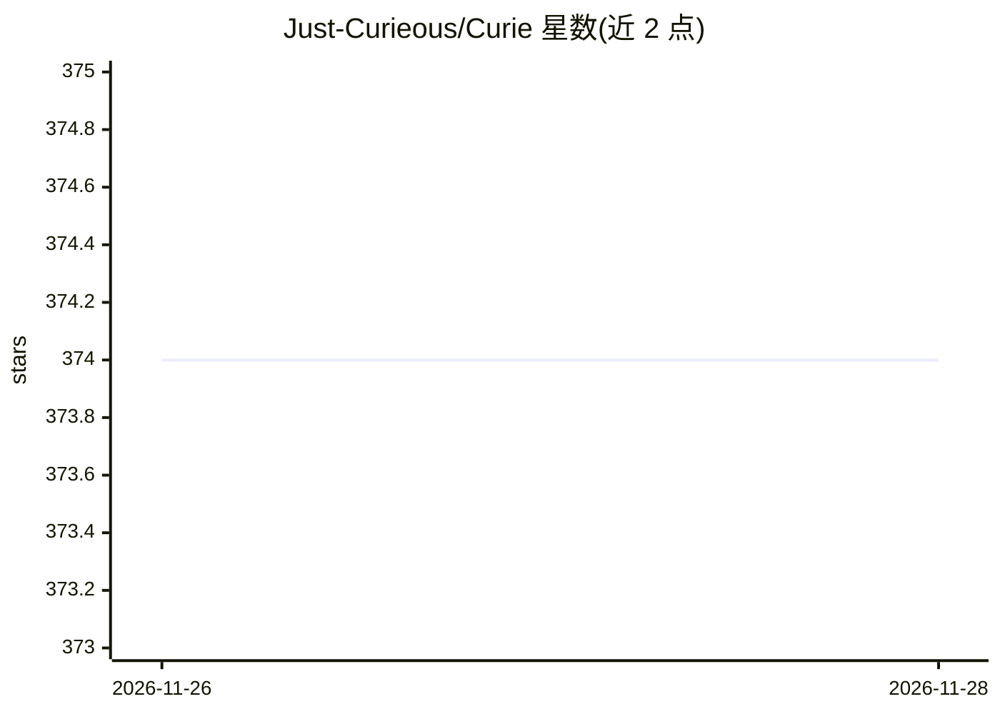

# Just-Curieous/Curie

⭐ 374 · Python · Apache-2.0 · 推送 2026-11-26 · [GitHub](https://github.com/Just-Curieous/Curie) · [官网](https://www.just-curieous.com/) · 组织维护

**给科研人员的 AI 实验自动化代理：从假设到报告端到端执行**

以 CLI/Python 包形式发布的实验代理框架，接收用户提出的科学问题或给定数据集与初始代码，自动完成假设制定、实验实现、执行、结果分析与反思，并生成实验报告与结果 Notebook。内置验证模块以保证流程规范性与可复现性，支持 ML 工程与科学发现场景，含 AutoML 功能寻找最优 ML 方案。实验在 Docker 容器中运行，ML 训练任务建议 GPU，实验可能持续数分钟以上，建议配合 tmux 使用。

## 筛选速览

| 维度 | 判定 | 备注 |
|---|---|---|
| AI 角色 | `ai-native` | 本体是模型或模型工具 |
| 许可风险 | `permissive` | Apache-2.0 |
| 部署形态 | `library` | 以包/库形式分发 |
| 模型依赖 | — | README 未给出锁定关系 |
| 硬件要求 | — | 无带数字的原话,不猜 |
| 安装摩擦 | `low` | 无编译、无系统依赖或容器化 |
| 成熟度 | `idea` | |

## 能力要点

- 端到端实验自动化：假设制定→实验实现→执行→结果分析→反思
- 内置验证模块保障方法流程、可靠性、可复现性
- 支持任意用户数据集与初始代码（Bring Your Own Dataset/Code）
- AutoML 功能在 MLE-Bench 多个任务上给出示例

## 适用场景

- 有一个待验证的科学问题，让代理自动设计并运行实验
- 有带噪声的数据集，寻找最稳健的 ML 方法
- 有数据集和初始代码，训练模型并解读结果

## 场景标签

`科研工具` `编码 Agent` `数据分析` · 领域:效率与自动化

## 证据(README 行号)

> L10: Curie is the first AI-agent framework designed for automated and rigorous scientific experimentation.
> L22: - 🚀 Automated Experimentation – From hypothesis formulation, experiment implementation, experiment execution, resul
> L11: Curie helps answer your curiosity through end-to-end experimentation automation, ensuring that every step—from hypo

## 星数曲线

2026-11-26 374 → 2026-11-28 374（+0）

---
*卡片 v1 · prompt 1.4 · 生成 2026-11-26 · 置信度 high · 依据 README sha `b56acea74ef7` · [字段定义](../../DATASET.md)*
