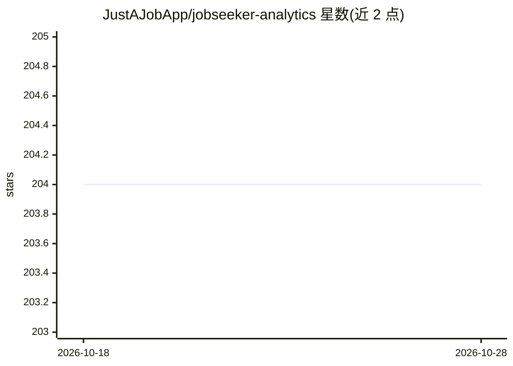

# JustAJobApp/jobseeker-analytics

⭐ 204 · TypeScript · MIT · 推送 2026-10-26 · [GitHub](https://github.com/JustAJobApp/jobseeker-analytics) · [官网](https://www.justajobapp.com) · 个人维护

**连接 Gmail 自动追踪求职进度的求职者仪表盘**

面向求职者的求职申请追踪工具：用户授权 Gmail 后，系统用预定义过滤规则（发件域名与关键词，清单公开于 applied_email_filter.yaml）筛出求职相关邮件，自动生成申请状态仪表盘，无需浏览器扩展或手动录入。仅存储元数据（发件人、状态、时间戳、公司、职位），不存邮件正文。提供网页版（免费）与职业教练门户，代码开源支持自托管（Docker Compose 或虚拟环境，详见 CONTRIBUTING.md）。使用 Google 付费 Gemini API 处理邮件，并公开了第三方安全审计结果。由单人开发者维护，PR 暂停接受。

## 筛选速览

| 维度 | 判定 | 备注 |
|---|---|---|
| AI 角色 | `ai-enhanced` | 去掉 AI 部分产品仍成立 |
| 许可风险 | `permissive` | MIT |
| 部署形态 | `self-host` | docker 或自建部署 |
| 模型依赖 | — | README 未给出锁定关系 |
| 硬件要求 | — | 无带数字的原话,不猜 |
| 安装摩擦 | `low` | 无编译、无系统依赖或容器化 |
| 成熟度 | — | 结构信号不足 |

## 能力要点

- Gmail 邮件自动解析为求职申请追踪仪表盘
- 公开的邮件过滤清单，仅存储元数据不存正文
- 支持自托管（Docker Compose / 虚拟环境）
- 面向教练的客户求职进度门户

## 适用场景

- 自动追踪投递的职位申请与面试进度，替代表格
- 职业教练实时查看客户的求职进展
- 技术人员自托管，掌控自己的邮件数据

## 场景标签

 · 领域:求职/生产力工具

## 证据(README 行号)

> L3: **An automated job application tracker that connects to your Gmail inbox.** Apply for jobs, receive confirmation ema
> L47: We use Google's paid Gemini API, which contractually forbids them from using your data to train their models. Googl
> L90: JustAJobApp is open source and you're welcome to run it on your own infrastructure. See CONTRIBUTING.md for full se

## 星数曲线

2026-10-18 204 → 2026-10-28 204（+0）

---
*卡片 v1 · prompt 1.4 · 生成 2026-10-22 · 置信度 mid · 依据 README sha `b47a69c56ecb` · [字段定义](../../DATASET.md)*
