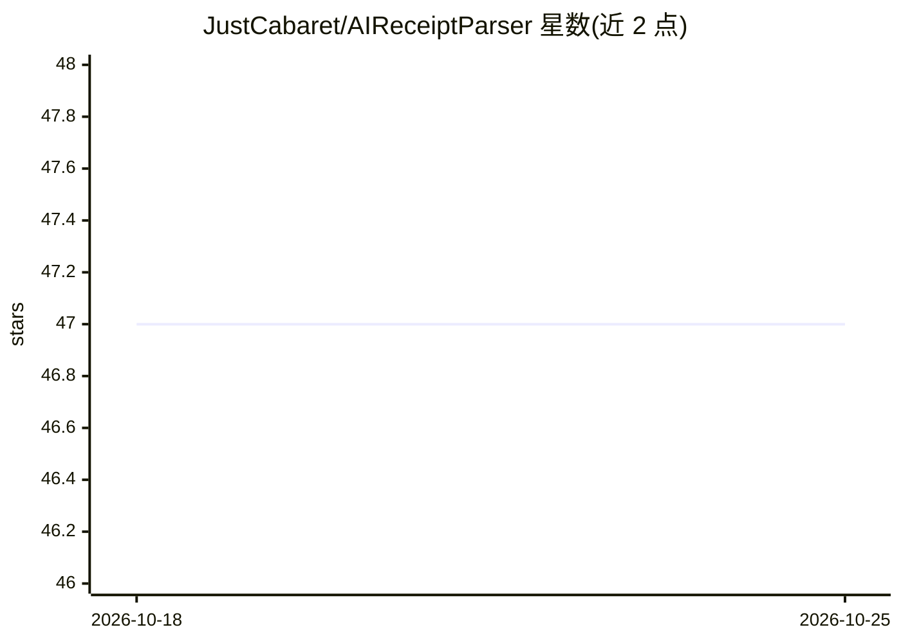

# JustCabaret/AIReceiptParser

⭐ 47 · Python · MIT · 推送 2026-03-12 · [GitHub](https://github.com/JustCabaret/AIReceiptParser) · 个人维护

**把收据图片解析为结构化数据的 OCR+GPT-4 网页应用**

基于 Flask 的收据解析应用：用户上传收据图片，Tesseract OCR 提取原始文本，OpenAI GPT-4 将其解析为结构化 JSON（商品、数量、价格、类别），数据存入 SQLite 并可导出 CSV。提供浏览器端响应式界面与 REST API（/process_receipt、/receipts 等）。内置 test API key 的 mock 模式，可绕过外部 API 与 Tesseract 做本地 UI 开发。面向个人自动化记账与数据录入场景，自部署需 Python 3.10+、Tesseract 与 OpenAI API key。

## 筛选速览

| 维度 | 判定 | 备注 |
|---|---|---|
| AI 角色 | `ai-native` | 本体是模型或模型工具 |
| 许可风险 | `permissive` | MIT |
| 部署形态 | `library` | 以包/库形式分发 |
| 模型依赖 | — | README 未给出锁定关系 |
| 硬件要求 | — | 无带数字的原话,不猜 |
| 安装摩擦 | `low` | 无编译、无系统依赖或容器化 |
| 成熟度 | — | 结构信号不足 |

## 能力要点

- Tesseract OCR 提取收据文本，GPT-4 解析为结构化 JSON
- 解析结果存 SQLite，支持 CSV 导出
- test API key mock 模式绕过外部 API 调用
- 提供 Flask API 端点与响应式网页界面

## 适用场景

- 把一堆纸质收据照片转成可记账的结构化数据
- 导出 CSV 给个人记账或报销流程
- 本地开发调试 UI 时用 mock 模式不消耗 API 额度

## 场景标签

`OCR` `文档解析` · 领域:知识与检索

## 证据(README 行号)

> L9: - **Image Processing**: Upload receipt images for automated text extraction using Tesseract OCR.
> L10: - **Language Model Parsing**: OpenAI's GPT-4 processes the raw OCR text into strict, structured JSON formatting.

## 星数曲线

2026-10-18 47 → 2026-10-25 47（+0）

---
*卡片 v1 · prompt 1.4 · 生成 2026-10-25 · 置信度 mid · 依据 README sha `401e0c3d2937` · [字段定义](../../DATASET.md)*
