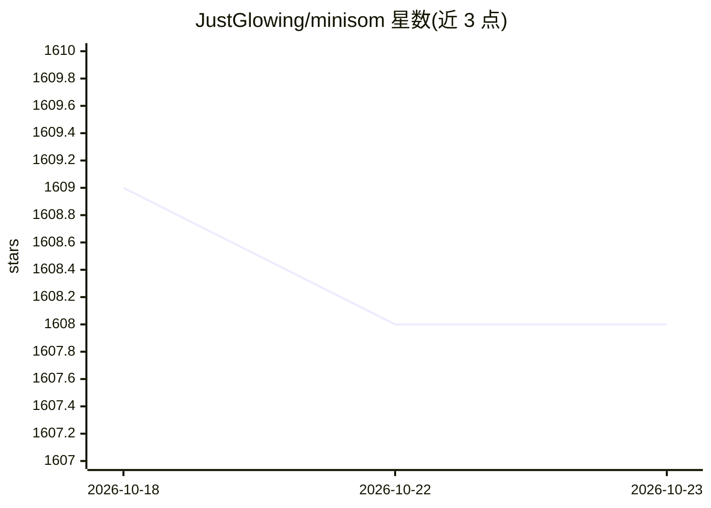

# JustGlowing/minisom

⭐ 1,608 · Python · MIT · 推送 2026-10-19 · [GitHub](https://github.com/JustGlowing/minisom) · 个人维护

**给研究者和学生的 NumPy 版自组织映射（SOM）最小实现库**

基于 NumPy 的自组织映射（SOM）最小化实现，仅依赖 numpy 库，将高维数据的非线性统计关系映射到低维几何表示。面向希望在其基础上构建的研究者和快速理解算法的学生。训练时接收 Numpy 矩阵或列表数据，支持通过 Numba 进行 JIT 加速训练（train_batch_offline_fast），模型可用 pickle 保存与加载。以 pip 包提供，附示例集与多篇第三方教程，被研究文献引用超过 520 次。

## 筛选速览

| 维度 | 判定 | 备注 |
|---|---|---|
| AI 角色 | `ai-native` | 本体是模型或模型工具 |
| 许可风险 | `permissive` | MIT |
| 部署形态 | `library` | 以包/库形式分发 |
| 模型依赖 | — | README 未给出锁定关系 |
| 硬件要求 | — | 无带数字的原话,不猜 |
| 安装摩擦 | `low` | 无编译、无系统依赖或容器化 |
| 成熟度 | — | 结构信号不足 |

## 能力要点

- 仅依赖 numpy 的最小化 SOM 实现，强调向量化编码风格
- 可选 Numba JIT 加速训练（train_batch_offline_fast）
- 模型支持 pickle 导出与重新加载
- 示例覆盖种子映射、手写数字映射、颜色量化、离群点检测等

## 适用场景

- 对高维数据做聚类、降维与离群点检测
- 研究者以 SOM 算法为基础做扩展实验
- 学生通过最小实现学习 SOM 算法细节

## 场景标签

 · 领域:机器学习/无监督学习

## 证据(README 行号)

> L10: MiniSom is a minimalistic and Numpy based implementation of the Self Organizing Maps (SOM) with optional JIT accele
> L12: The project initially aimed for a minimalistic implementation of the Self-Organizing Map (SOM) algorithm, focusing 

## 星数曲线

2026-10-18 1,609 → 2026-10-23 1,608（-1）

---
*卡片 v1 · prompt 1.4 · 生成 2026-10-21 · 置信度 high · 依据 README sha `69dace6fc7f0` · [字段定义](../../DATASET.md)*
