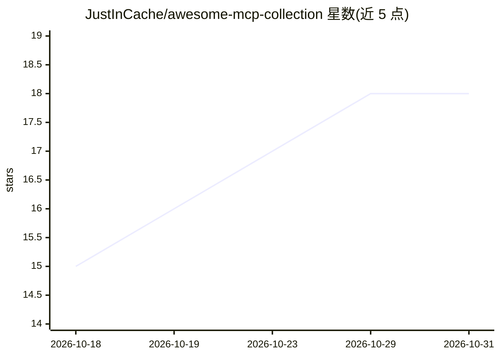

# JustInCache/awesome-mcp-collection

⭐ 18 · Python · MIT · 推送 2026-10-30 · [GitHub](https://github.com/JustInCache/awesome-mcp-collection) · [官网](https://github.com/JustInCache/awesome-mcp-collection) · 个人维护

**MCP 服务器策展清单：按类别/技术栈组织并附配置**

Model Context Protocol 服务器的策展清单：收录官方参考实现与社区服务器，按开发、云基础设施、数据库、Web 搜索、办公协作、金融、安全、AI/ML 等类别组织成表格，标注仓库、星数、语言与传输方式。提供快速上手指引：选择客户端（Claude Desktop/Cursor/VS Code/Windsurf）、通过 npx 或 uvx 安装服务器、配置 JSON，并在 configs/ 目录提供按用例的现成配置。面向为 AI 助手接入外部工具的开发者。

## 筛选速览

| 维度 | 判定 | 备注 |
|---|---|---|
| AI 角色 | `ai-knowledge` | 知识聚合/清单类 |
| 许可风险 | `permissive` | MIT |
| 部署形态 | `library` | 以包/库形式分发 |
| 模型依赖 | — | README 未给出锁定关系 |
| 硬件要求 | — | 无带数字的原话,不猜 |
| 安装摩擦 | `low` | 无编译、无系统依赖或容器化 |
| 成熟度 | — | 结构信号不足 |

## 能力要点

- 收录 Anthropic 官方参考实现与 8 大类社区服务器条目
- 提供 npx/uvx 安装命令与客户端 JSON 配置示例
- configs/ 目录提供按用例的现成配置
- 条目标注仓库、星数、语言与传输方式

## 适用场景

- 为 Claude/Cursor 等 AI 客户端挑选合适的 MCP 服务器
- 查阅各类别下可用 MCP 服务器及其安装方式
- 按用例获取现成的 MCP 客户端配置

## 场景标签

`精选清单` · 领域:学习与行业

## 证据(README 行号)

> L10: > **The most comprehensive, curated collection of Model Context Protocol (MCP) servers.**
> L72: |Server|Package|Description|Transport|

## 星数曲线

2026-10-18 15 → 2026-10-31 18（+3）

---
*卡片 v1 · prompt 1.4 · 生成 2026-10-29 · 置信度 high · 依据 README sha `df6f3e34c604` · [字段定义](../../DATASET.md)*
