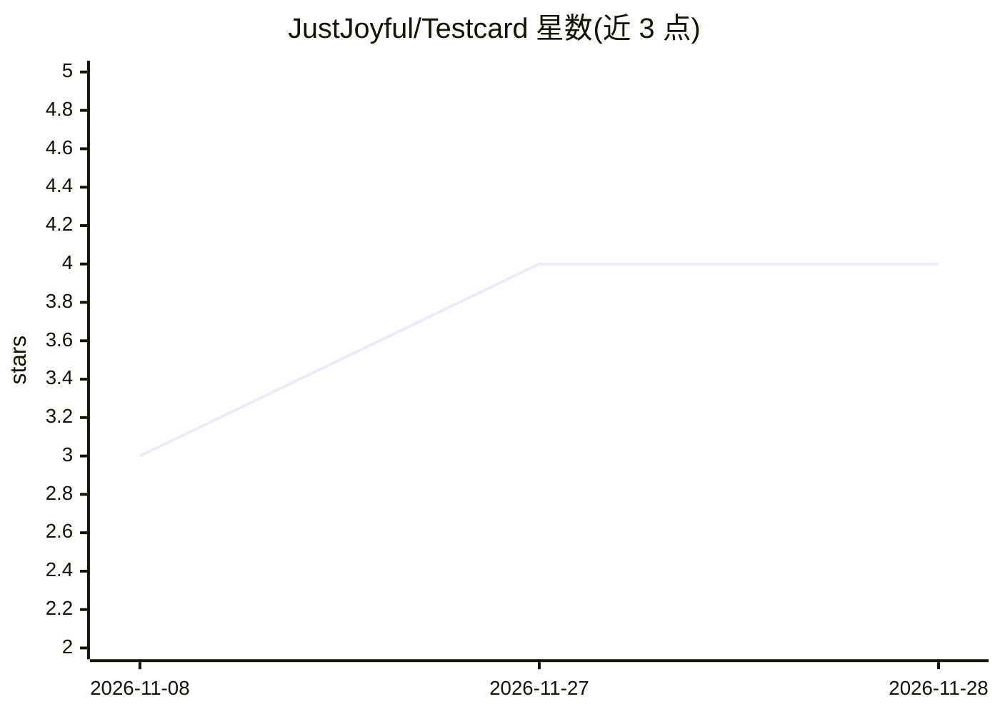

# JustJoyful/Testcard

⭐ 4 · Python · MIT · 推送 2026-10-31 · [GitHub](https://github.com/JustJoyful/Testcard) · 个人维护

**给视频质量评估研究者：可复现的无参考视频质量基准与对比实验**

一项在冻结骨干特征上比较时序头的可复现研究：以 ResNet-50 与 DINOv2 两种缓存特征为输入，对比 mean-pool MLP、Bi-GRU、Transformer、Mamba 四种时序头与岭回归基线，训练于 KoNViD-1k，跨数据集测试于 LIVE-VQC，报告 SRCC/PLCC/KRCC 与配对 bootstrap 置信区间，并预注册研究问题与协议。附带 Docker 打包的 CPU demo，可对上传视频片段打分；模型检查点发布在 Hugging Face。结果记录了时序头间差异未超出 ±0.01 SRCC 边际等发现。

## 筛选速览

| 维度 | 判定 | 备注 |
|---|---|---|
| AI 角色 | `ai-knowledge` | 知识聚合/清单类 |
| 许可风险 | `permissive` | MIT |
| 部署形态 | `self-host` | docker 或自建部署 |
| 模型依赖 | — | README 未给出锁定关系 |
| 硬件要求 | `cpu-ok` | |
| 安装摩擦 | `low` | 无编译、无系统依赖或容器化 |
| 成熟度 | — | 结构信号不足 |

## 能力要点

- 四种时序头 + 岭回归基线在冻结缓存特征上的受控对比
- KoNViD-1k 训练、LIVE-VQC 跨数据集测试的完整协议与统计检验
- Docker 镜像直接运行的 CPU demo，无需克隆仓库或 Git LFS
- 模型检查点与卡片发布于 Hugging Face

## 适用场景

- 复现或扩展无参考视频质量评估的对比实验
- 查找在 KoNViD-1k/LIVE-VQC 上带置信区间的基线结果
- 快速在本地对上传视频跑质量打分 demo

## 场景标签

`科研工具` `模型评测` · 领域:评测与运维

## 证据(README 行号)

> L5: A controlled comparison of four temporal heads and a ridge baseline on frozen, cached backbone features for no-refer
> L19: - **Question.** For NR-VQA on cached features, does the choice of temporal head (mean pooling, Bi-GRU, Transformer,
> L30: No-reference video quality models predict a mean opinion score (MOS) from a video alone. Many recent models pair a 

## 星数曲线

2026-11-08 3 → 2026-11-28 4（+1）

---
*卡片 v1 · prompt 1.4 · 生成 2026-11-22 · 置信度 mid · 依据 README sha `97d07bfbdc0d` · [字段定义](../../DATASET.md)*
