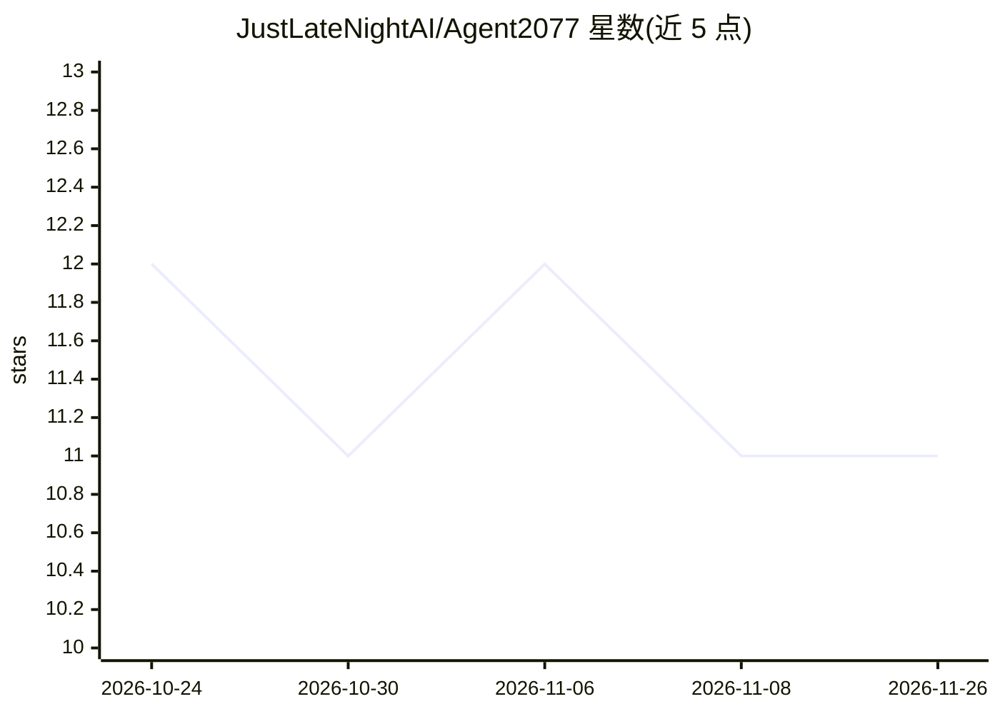

# JustLateNightAI/Agent2077

⭐ 11 · TypeScript · AGPL-3.0 · 推送 2026-06-18 · [GitHub](https://github.com/JustLateNightAI/Agent2077) · 个人维护

**自托管的本地 AI agent 工作台：聊天、写码、部署应用到浏览器 UI**

在 Linux 机器上运行的自托管 AI agent 工作台，提供浏览器 UI，连接任意 OpenAI 兼容模型端点（LM Studio、OpenRouter、远程 vLLM 等）。Agent 具备文件读写编辑、shell 命令执行、Docker 应用构建部署（App Store）、本地 SearXNG 网络搜索、跨会话记忆与技能指令存储、多模型按标签编排路由，以及读取并修改自身代码的 Self-Dev 模式（含快照与回滚）。install.sh 一键安装并配置 systemd 服务；Docker 为可选依赖，缺失时 App Store 与代码执行不可用。要求 Node.js 22+ 与至少一个 LLM 端点。

## 筛选速览

| 维度 | 判定 | 备注 |
|---|---|---|
| AI 角色 | `ai-ecosystem` | LLM/agent 周边工具 |
| 许可风险 | `viral` | AGPL-3.0 |
| 部署形态 | `library` | 以包/库形式分发 |
| 模型依赖 | — | README 未给出锁定关系 |
| 硬件要求 | — | 无带数字的原话,不猜 |
| 安装摩擦 | `low` | 无编译、无系统依赖或容器化 |
| 成熟度 | — | 结构信号不足 |

## 能力要点

- 连接任意 OpenAI 兼容端点，按能力标签做多模型编排与 VRAM 自动管理
- App Store：agent 生成 Web 应用并以独立 Docker 容器在局域网提供服务
- 持久记忆与可编辑的技能指令文件，跨会话回忆上下文
- Self-Dev 模式：agent 修改自身源码，带快照回滚的部署流程

## 适用场景

- 在自己电脑上搭建不依赖云账号的私有 agent 工作环境
- 用自然语言让 agent 建小工具并部署到局域网
- 多台设备通过浏览器访问同一 agent 工作台
- 让 agent 管理项目代码、跑测试并按任务类型切换模型

## 场景标签

`AI 助手` `编码 Agent` · 领域:编码与开发

## 证据(README 行号)

> L18: Agent2077 is a locally-hosted AI agent with a web UI. You point it at any OpenAI-compatible model endpoint (LM Stud
> L23: - Build web apps and games, containerize them with Docker, and serve them on your network
> L32: - **Node.js**: 22+ (installed automatically by `install.sh` via nvm)

## 星数曲线

2026-10-24 12 → 2026-11-26 11（-1）

---
*卡片 v1 · prompt 1.4 · 生成 2026-11-19 · 置信度 mid · 依据 README sha `78eea49bef13` · [字段定义](../../DATASET.md)*
