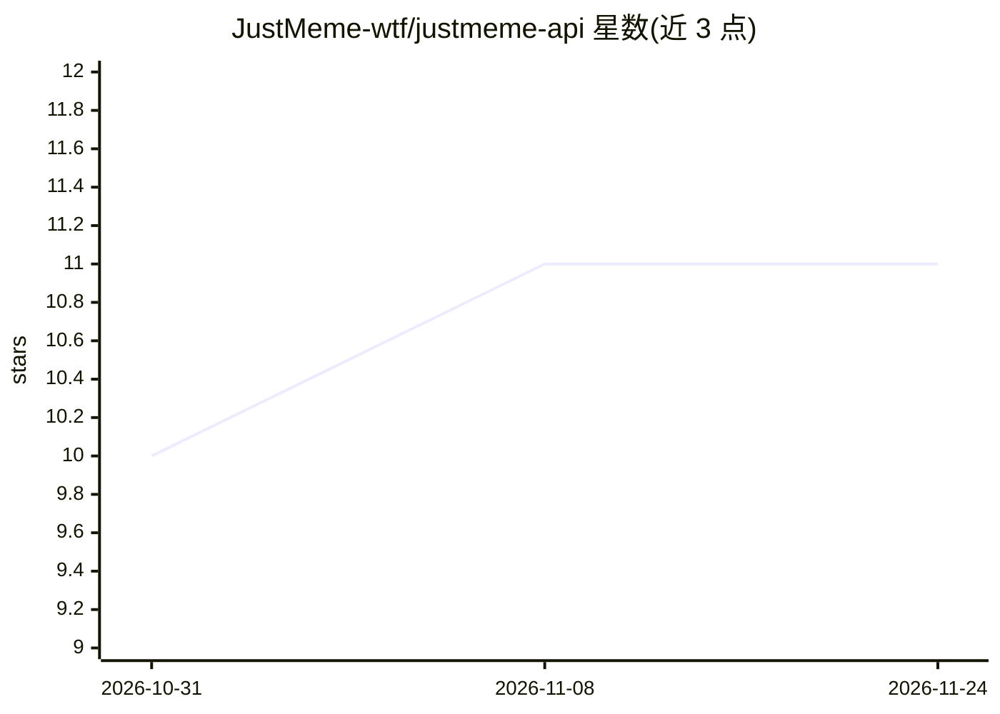

# JustMeme-wtf/justmeme-api

⭐ 11 · MIT · 推送 2026-05-12 · [GitHub](https://github.com/JustMeme-wtf/justmeme-api) · [官网](https://justmeme.wtf/api-docs) · 个人维护

**免费免鉴权的梗图模板 API，附 AI 生成梗图端点**

提供 REST 形式的梗图 API：2,400+ 模板支持分页列表、按名称搜索、分类浏览、随机获取与热门 Top 20；POST /ai-generate 端点根据文字描述由 AI 选取模板并生成梗图文案，返回模板、文本与编辑器直链。无需鉴权，每 IP 限速 60 次/分钟，启用 CORS，响应采用统一信封格式。README 提供 JavaScript/Python/cURL 调用示例，采用 MIT 许可。

## 筛选速览

| 维度 | 判定 | 备注 |
|---|---|---|
| AI 角色 | `ai-native` | 本体是模型或模型工具 |
| 许可风险 | `permissive` | MIT |
| 部署形态 | `None` |  |
| 模型依赖 | — | README 未给出锁定关系 |
| 硬件要求 | — | 无带数字的原话,不猜 |
| 安装摩擦 | `low` | 无编译、无系统依赖或容器化 |
| 成熟度 | — | 结构信号不足 |

## 能力要点

- 2,400+ 梗图模板：搜索/分类/随机/热门端点
- /ai-generate 依提示词选模板并生成文案
- 无需鉴权，60 次/分钟限速，CORS 开放

## 适用场景

- 在应用里按名称或分类检索梗图模板
- 用一句话描述让 AI 生成梗图并跳转编辑器
- 做机器人或脚本时随机取梗图

## 场景标签

`AI 写作` · 领域:内容生成

## 证据(README 行号)

> L3: Free, open meme API with 2,400+ templates. No auth required.
> L19: |POST|`/ai-generate`|AI-powered meme generation|
> L91: The `/ai-generate` endpoint uses AI to pick the best template and write meme text based on your prompt. Just descri

## 星数曲线

2026-10-31 10 → 2026-11-24 11（+1）

---
*卡片 v1 · prompt 1.4 · 生成 2026-11-19 · 置信度 high · 依据 README sha `f8fe93b0daff` · [字段定义](../../DATASET.md)*
