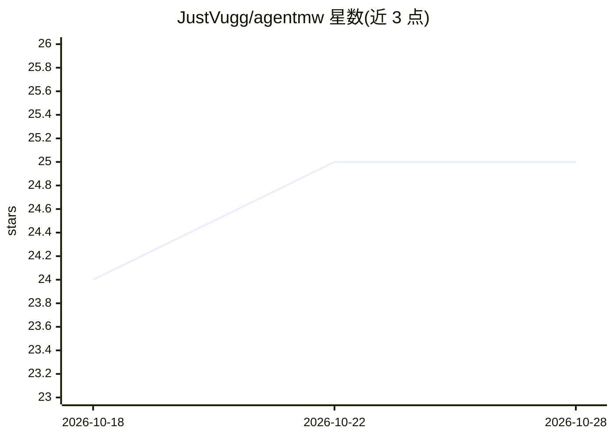

# JustVugg/agentmw

⭐ 25 · Python · Apache-2.0 · 推送 2026-05-19 · [GitHub](https://github.com/JustVugg/agentmw) · 个人维护

**AI agent 中间件：运行中故障检测、上下文压缩与推理记忆库**

Python 库形式的 agent 中间件，包一层 LLM 客户端（wrap/wrap_async），运行中用 LLM 或确定性正则监测循环调用、冗余工具调用、矛盾、幻觉等失败类别；截断过期 tool_result 做上下文压缩；以 SQLite + fastembed 本地向量召回沉淀跨运行的推理模式库。附带 time-travel CLI 回放 trace 与 MCP server（可接入 Claude Desktop/Cursor）。支持 Ollama/OpenAI/Anthropic/OpenRouter 提供方，Apache-2.0。

## 筛选速览

| 维度 | 判定 | 备注 |
|---|---|---|
| AI 角色 | `ai-ecosystem` | LLM/agent 周边工具 |
| 许可风险 | `permissive` | Apache-2.0 |
| 部署形态 | `library` | 以包/库形式分发 |
| 模型依赖 | local-ok | 支持本地模型 |
| 硬件要求 | — | 无带数字的原话,不猜 |
| 安装摩擦 | `low` | 无编译、无系统依赖或容器化 |
| 成熟度 | — | 结构信号不足 |

## 能力要点

- LLM 监测 + 启发式正则回退，识别 loop/冗余调用/矛盾/幻觉等失败类别
- SQLite 推理库 + fastembed 本地语义召回（BGE-small ONNX，30MB）
- time-travel CLI 回放 trace、定位不可逆点并量化浪费 token
- 提供 MCP server，暴露 recall/save/check_trace/stats 工具

## 适用场景

- 在我的 agent 应用里拦截运行中的循环与幻觉等失败
- 压缩过期工具结果以控制上下文长度
- 跨运行沉淀和召回可复用的推理模式
- 作为 MCP 工具接入 Claude Desktop 或 Cursor

## 场景标签

`LLM 可观测性` `Agent 记忆` · 领域:Agent 开发

## 证据(README 行号)

> L3: Open-source middleware that catches mid-run failures, compresses stale
> L16: |**LLM monitor**|One call to your provider (Ollama / OpenAI / Anthropic / OpenRouter) classifies the latest turns f

## 星数曲线

2026-10-18 24 → 2026-10-28 25（+1）

---
*卡片 v1 · prompt 1.4 · 生成 2026-10-27 · 置信度 high · 依据 README sha `37f28d0e0aa7` · [字段定义](../../DATASET.md)*
