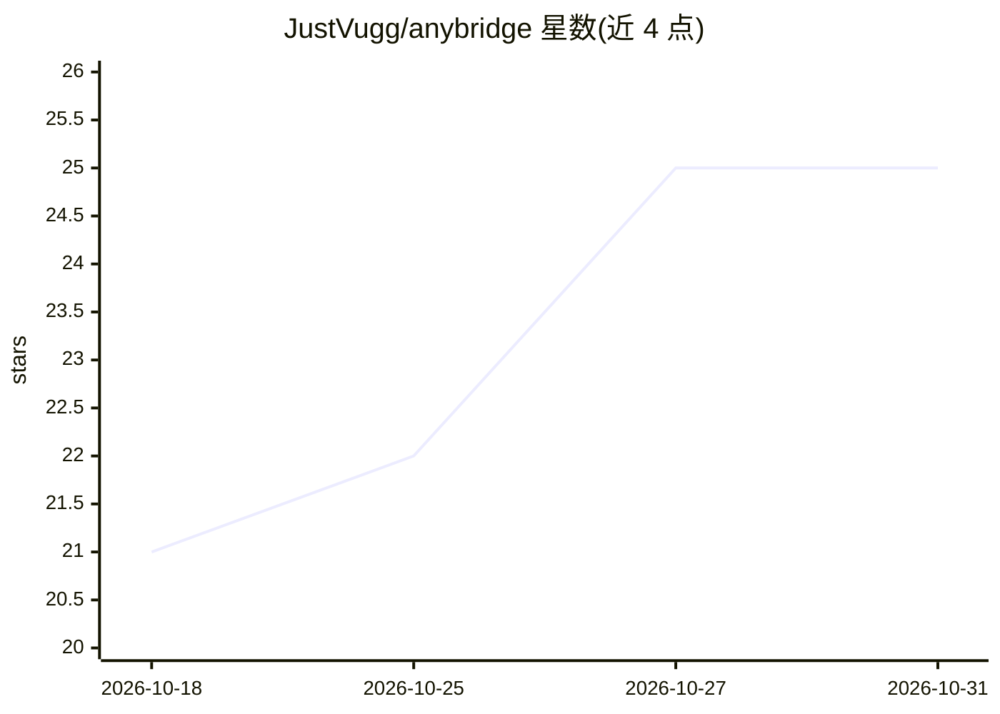

# JustVugg/anybridge

⭐ 25 · Python · MIT · 推送 2026-09-03 · [GitHub](https://github.com/JustVugg/anybridge) · 个人维护

**把任意网站变成 MCP 工具供 AI agent 调用的桥接器**

Python 实现的 MCP 桥接工具：在真实浏览器中打开网站，捕获站点原生 WebMCP 工具；对无 WebMCP 的站点则从实时 DOM 生成桥接，另提供约 40 个通用工具（导航、读页、PDF 提取、点击、表单填写等），统一通过 MCP 暴露给 Claude Code、Codex 等客户端。加载策略为 HTTP 优先、必要时 Chromium，失败时降级到缓存与 Internet Archive。可经 uvx 一条命令运行或 pip 源码安装，尚不在 PyPI 上。

## 筛选速览

| 维度 | 判定 | 备注 |
|---|---|---|
| AI 角色 | `ai-ecosystem` | LLM/agent 周边工具 |
| 许可风险 | `permissive` | MIT |
| 部署形态 | `library` | 以包/库形式分发 |
| 模型依赖 | — | README 未给出锁定关系 |
| 硬件要求 | — | 无带数字的原话,不猜 |
| 安装摩擦 | `low` | 无编译、无系统依赖或容器化 |
| 成熟度 | — | 结构信号不足 |

## 能力要点

- 捕获站点原生 WebMCP 工具，无 WebMCP 时从实时 DOM 自动生成桥接
- 约 40 个通用页面工具：navigate/read_page/snapshot/extract/screenshot 等
- PDF 以分页文本返回，支持按页码提取
- 提供 TUI、CLI、MCP serve 与 Python 库（LangChain/OpenAI/Anthropic 工具格式）四种使用方式

## 适用场景

- 让 Claude Code 或 Codex 通过 MCP 读取和操作任意网站
- agent 自动填表、点击、抓取结构化数据或读取网站 PDF
- 把某个网站封装成 LangChain/LangGraph agent 可用的工具集

## 场景标签

`浏览器自动化` `网页抓取` · 领域:效率与自动化

## 证据(README 行号)

> L8: page in a real browser and re-exposes it over the **Model Context Protocol**, so
> L9: Claude Code, Codex, or anything else that speaks MCP can read the page, fill its
> L73: claude mcp add anybridge -- anybridge serve

## 星数曲线

2026-10-18 21 → 2026-10-31 25（+4）

---
*卡片 v1 · prompt 1.4 · 生成 2026-10-27 · 置信度 mid · 依据 README sha `d4cd202bae6d` · [字段定义](../../DATASET.md)*
