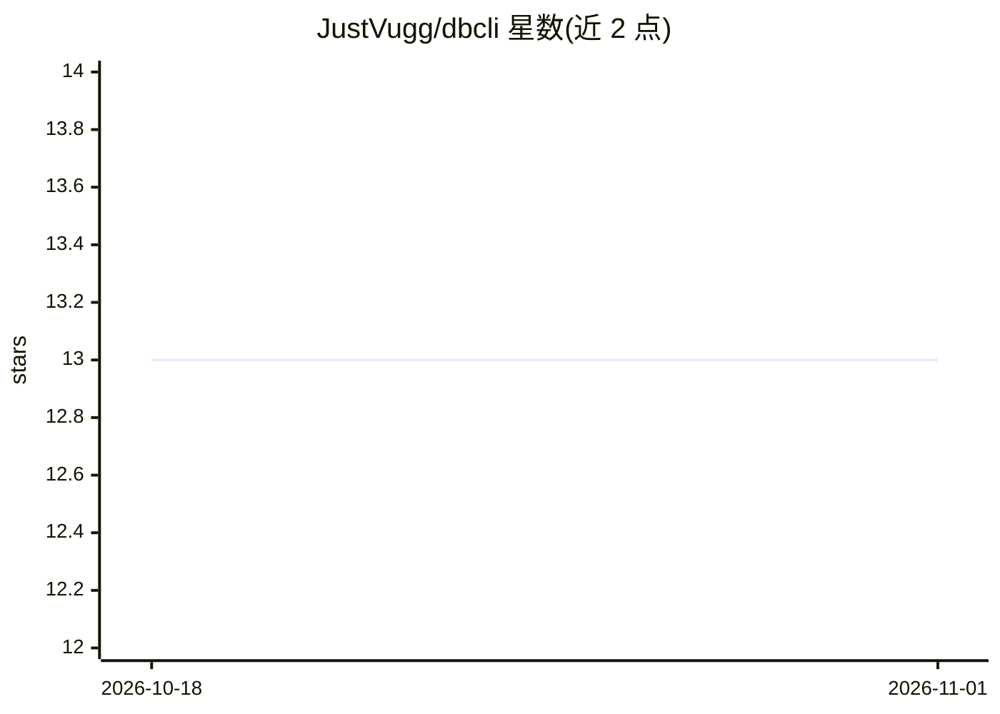

# JustVugg/dbcli

⭐ 13 · Python · MIT · 推送 2026-03-02 · [GitHub](https://github.com/JustVugg/dbcli) · 个人维护

**面向 AI agent 的数据库 CLI：一条命令输出全库上下文**

命令行数据库客户端，设计目标是让 AI agent 通过 shell 以最少 token 理解和操作数据库：`snap` 一条命令输出 schema、行数、列画像（distinct/nulls/样本）与 ER 关系；输出为紧凑格式并针对 LLM 消费优化（默认 LIMIT 100、stderr 错误格式、语义退出码）。支持 SQLite/PostgreSQL/MySQL/MariaDB/DuckDB/ClickHouse/SQL Server，驱动可选安装、按需加载；README 提供 Claude Code、Cursor/Windsurf 及 LangChain 等 agent 的接入配置示例，并含与 MCP 的开销对比表。

## 筛选速览

| 维度 | 判定 | 备注 |
|---|---|---|
| AI 角色 | `ai-ecosystem` | LLM/agent 周边工具 |
| 许可风险 | `permissive` | MIT |
| 部署形态 | `library` | 以包/库形式分发 |
| 模型依赖 | — | README 未给出锁定关系 |
| 硬件要求 | — | 无带数字的原话,不猜 |
| 安装摩擦 | `low` | 无编译、无系统依赖或容器化 |
| 成熟度 | — | 结构信号不足 |

## 能力要点

- `snap` 单命令输出 schema+列画像+ERD
- 支持 7 种数据库，驱动 extras 可选安装、懒加载
- 输出针对 LLM 优化：默认 LIMIT 100、语义退出码、stderr 错误
- 提供 SKILL.md 技能文件与各 agent 框架接入示例

## 适用场景

- 让编程 agent 在 shell 中查询和理解数据库结构
- 给 agent 的 system prompt 注入数据库操作说明
- CI/CD 中通过 DBCLI_URL 环境变量免连接直接查询

## 场景标签

 · 领域:开发者工具/数据库

## 证据(README 行号)

> L3: Database CLI built for AI agents. One command to understand any database.
> L19: AI agents already have shell access. MCP wastes hundreds of tokens per message on tool schemas and protocol overhea
> L92: Every output is optimized for LLM consumption, not human terminals:

## 星数曲线

2026-10-18 13 → 2026-11-01 13（+0）

---
*卡片 v1 · prompt 1.4 · 生成 2026-10-31 · 置信度 high · 依据 README sha `aae50f21c607` · [字段定义](../../DATASET.md)*
