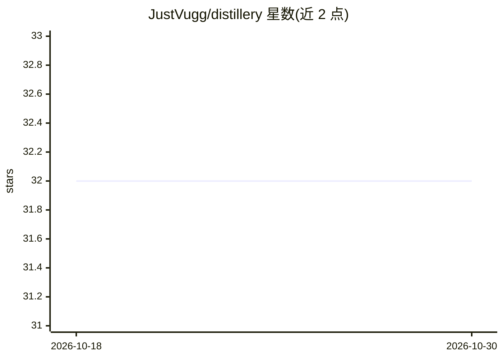

# JustVugg/distillery

⭐ 32 · Python · MIT · 推送 2026-04-23 · [GitHub](https://github.com/JustVugg/distillery) · 个人维护

**把 PDF/文本/URL 文档转化为可溯源的指令微调数据集**

面向微调数据准备的 Python 库与 CLI：从 PDF、文本文件和 URL 读取文档，经分块、种子提议、基于原文块的有据回答生成、嵌入去重、内容词重叠幻觉检查与 LLM 裁判打分（1-10 分，低于阈值拒绝）后，导出 JSONL、OpenAI messages、HF datasets、DPO 偏好对等格式，并用 manifest.json 记录来源与拒绝原因。支持任何 OpenAI 兼容端点（含本地 Ollama），默认哈希嵌入器使其零 ML 依赖即可运行，另附 MCP 服务器供 agent 驱动生成。限制：质量依赖裁判模型强度，不做爬虫与奖励模型训练。

## 筛选速览

| 维度 | 判定 | 备注 |
|---|---|---|
| AI 角色 | `ai-ecosystem` | LLM/agent 周边工具 |
| 许可风险 | `permissive` | MIT |
| 部署形态 | `library` | 以包/库形式分发 |
| 模型依赖 | local-ok | 支持本地模型 |
| 硬件要求 | — | 无带数字的原话,不猜 |
| 安装摩擦 | `low` | 无编译、无系统依赖或容器化 |
| 成熟度 | — | 结构信号不足 |

## 能力要点

- 每条样本溯源到来源 chunk，manifest.json 记录生成与拒绝详情
- LLM 裁判打分 + 嵌入余弦去重 + 幻觉重叠检查的多级质控
- 导出 JSONL/OpenAI messages/HF datasets/DPO 对等常见格式
- 提供 MCP 服务器，可由 Claude Desktop/Cursor 等 agent 驱动

## 适用场景

- 把内部 PDF 或网页文档转成可微调的指令数据集
- 在生成训练数据时过滤幻觉与低质量样本
- 生成 DPO 偏好对供 TRL/Axolotl 等训练器使用

## 场景标签

`微调` · 领域:训练与推理

## 证据(README 行号)

> L5: Distillery is a focused Python library and CLI for building training datasets from real sources (PDFs, text files, U
> L17: Most teams fine-tune on garbage datasets because producing a clean one is manual work. Distillery automates the loo
> L158: - **No reward model training.** DPO pair export is supported; actual DPO/RM training is out of scope — feed the pa

## 星数曲线

2026-10-18 32 → 2026-10-30 32（+0）

---
*卡片 v1 · prompt 1.4 · 生成 2026-10-26 · 置信度 high · 依据 README sha `1ece657eef97` · [字段定义](../../DATASET.md)*
