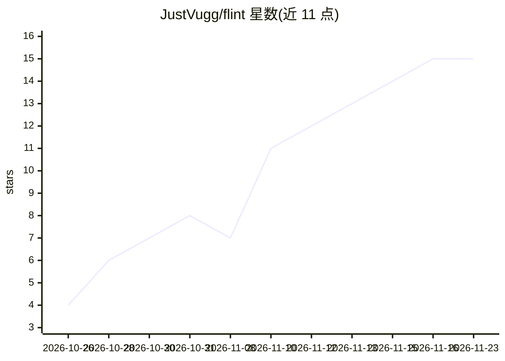

# JustVugg/flint

⭐ 15 · Python · Apache-2.0 · 推送 2026-10-21 · [GitHub](https://github.com/JustVugg/flint) · 个人维护

**给 AI agent 的上下文压缩与持久记忆工具层**

在 agent-tool 层工作的 CLI/JSON 工具：对代码、JSON 和文本做可逆压缩并按需精确恢复原内容；提供聚焦读取（完整定义/行区间/匹配）、字节预算内的上下文打包、决策持久记忆（可搜索、保留历史、可跟踪源文件新鲜度）以及绑定文件版本的编辑（源变更即拒绝写入）。标准库核心，无需模型或服务器，仅支持 Python 3.11+ 的 Linux/WSL。安装器可为 Codex 与 Claude Code 配置用户技能，但不会自动拦截工具调用。

## 筛选速览

| 维度 | 判定 | 备注 |
|---|---|---|
| AI 角色 | `ai-ecosystem` | LLM/agent 周边工具 |
| 许可风险 | `permissive` | Apache-2.0 |
| 部署形态 | `None` |  |
| 模型依赖 | — | README 未给出锁定关系 |
| 硬件要求 | — | 无带数字的原话,不猜 |
| 安装摩擦 | `low` | 无编译、无系统依赖或容器化 |
| 成熟度 | — | 结构信号不足 |

## 能力要点

- 代码/JSON/文本的可逆压缩与原内容精确恢复
- 持久记忆：保存决策、搜索、历史版本与源文件新鲜度跟踪
- 绑定读取版本的编辑：源已变更则拒绝写入
- 字节预算内的上下文打包与聚焦读取；无需模型或服务器

## 适用场景

- 让编码 agent 在 token 预算内携带更多有效上下文
- 跨会话保存并召回项目决策，且源码变更后标记过期
- 确保 agent 的编辑只应用到它读取过的文件版本

## 场景标签

`Agent 记忆` · 领域:Agent 开发

## 证据(README 行号)

> L11: It works at the agent-tool layer: connect the CLI or JSON interface to your
> L12: workflow, independently of your model or provider. **Python 3.11+ · Linux / WSL ·

## 星数曲线

2026-10-26 4 → 2026-11-23 15（+11）

---
*卡片 v1 · prompt 1.4 · 生成 2026-11-18 · 置信度 high · 依据 README sha `cfd04e1e5d8f` · [字段定义](../../DATASET.md)*
