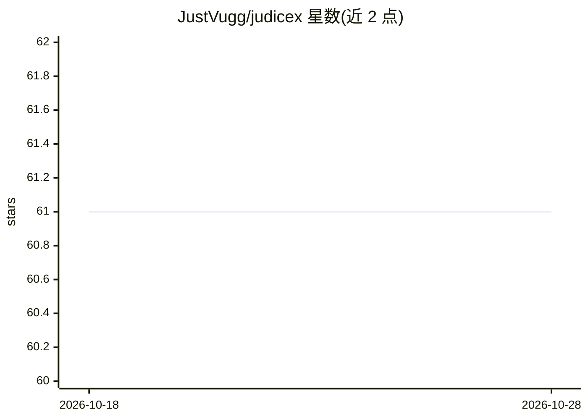

# JustVugg/judicex

⭐ 61 · Python · Apache-2.0 · 推送 2026-05-16 · [GitHub](https://github.com/JustVugg/judicex) · 个人维护

**给律师与法律团队的开源法律 AI 工作台**

面向律师和法律团队的自托管法律 AI 工作区（Apache 2.0，v0.2.0-alpha 原型）：导入官方法律来源与私有案卷文件到本地 SQLite 知识库，运行确定性工作流检查、案卷分析（对照论点列出证据完整度），在分屏编辑器中生成可导出 DOCX/PDF 的文书草稿，并与 LLM 对话。答案契约强制 grounded/limited/abstain/chat 四态，引证仅绑定到已检索文档，证据不足时拒答。支持 Ollama/OpenAI/Anthropic/OpenAI 兼容后端或无 LLM 模式；提供 Flask Web UI、CLI 和 MCP stdio 服务器，OCR 经 Ollama 完成。声明不提供法律意见。

## 筛选速览

| 维度 | 判定 | 备注 |
|---|---|---|
| AI 角色 | `ai-native` | 本体是模型或模型工具 |
| 许可风险 | `permissive` | Apache-2.0 |
| 部署形态 | `library` | 以包/库形式分发 |
| 模型依赖 | local-ok | 支持本地模型 |
| 硬件要求 | — | 无带数字的原话,不猜 |
| 安装摩擦 | `low` | 无编译、无系统依赖或容器化 |
| 成熟度 | `idea` | |

## 能力要点

- 答案契约失败关闭：grounded/limited/abstain/chat 四态，引证仅绑定 document_id
- 双层证据模型：可引用的法律来源与不可引用的操作笔记分离
- 法律来源版本化（effective_from/effective_to），支持按日期查询条文
- 多 Provider（Ollama/OpenAI/Anthropic/OpenAI 兼容）及无 LLM 确定性模式

## 适用场景

- 律师在本地工作站管理案卷、起草并导出文书
- 对照论点做证据完整度分析（present/partial/missing）
- 不外发客户数据、在律所私有服务器内运行的法律问答

## 场景标签

`知识库管理` `RAG` `文档问答` · 领域:知识与检索

## 证据(README 行号)

> L11: Judicex is a workspace for lawyers and legal teams. You can ingest official
> L104: - Grounded answer engine with citations bound to evidence.

## 星数曲线

2026-10-18 61 → 2026-10-28 61（+0）

---
*卡片 v1 · prompt 1.4 · 生成 2026-10-24 · 置信度 mid · 依据 README sha `25d6f6e5eaf3` · [字段定义](../../DATASET.md)*
