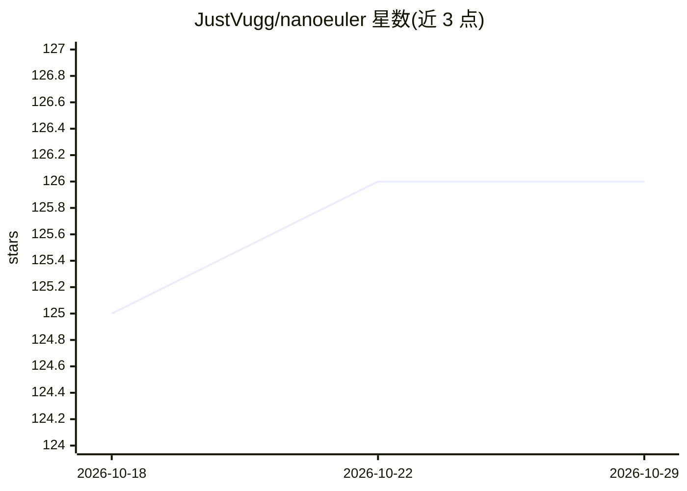

# JustVugg/nanoeuler

⭐ 126 · Cuda · MIT · 推送 2026-06-18 · [GitHub](https://github.com/JustVugg/nanoeuler) · 个人维护

**从零手写 C/CUDA 实现的 GPT-2 级 LLM 训练管线**

纯 C 与 CUDA 从零实现的 decoder-only transformer：手写前向/反向传播（每个梯度经双精度有限差分校验）、字节级 BPE 分词器、手写 FlashAttention 与 cuBLAS 矩阵乘。CPU 路径（libm + OpenMP）可训练约 1M 参数展示模型，CUDA 引擎在单张 RTX 4070 上预训练约 116M 参数模型并经 Alpaca SFT 转为聊天模型。数据来自 Project Gutenberg 与 FineWeb-Edu。定位为研究/教学项目，作者声明模型无真实世界知识、非可用助手。

## 筛选速览

| 维度 | 判定 | 备注 |
|---|---|---|
| AI 角色 | `ai-native` | 本体是模型或模型工具 |
| 许可风险 | `permissive` | MIT |
| 部署形态 | `None` |  |
| 模型依赖 | — | README 未给出锁定关系 |
| 硬件要求 | `cpu-ok` | |
| 安装摩擦 | `high` | 编译与系统依赖俱全 |
| 成熟度 | — | 结构信号不足 |

## 能力要点

- 手写反向传播，全部参数张量经双精度梯度校验（RoPE/SwiGLU/GQA/MTP 均覆盖）
- 手写 FlashAttention（分块、在线 softmax，无 T×T 矩阵）使训练步约 3 倍提速
- CPU 展示模型无外部依赖，CUDA 引擎训练约 116M 参数模型
- 完整 pretrain→SFT 两阶段聊天管线，checkpoint 每 5000 步可断点续训

## 适用场景

- 学习 LLM 从分词器到反向传播的完整工程实现
- 在单张消费级 GPU 上复现 pretrain→SFT 流程
- 对照 CPU 参考实现验证 CUDA 内核正确性

## 场景标签

`模型训练` `教程课程` · 领域:学习与行业

## 证据(README 行号)

> L3: A GPT-2-class language model built **entirely from scratch in C/CUDA** — no PyTorch, no
> L9: validated against a CPU reference by a full-model gradient check — trains a **~116M-parameter**
> L125: This is a from-scratch text generator and a complete, understandable training pipeline —

## 星数曲线

2026-10-18 125 → 2026-10-29 126（+1）

---
*卡片 v1 · prompt 1.4 · 生成 2026-10-23 · 置信度 high · 依据 README sha `7178fe4e39d1` · [字段定义](../../DATASET.md)*
