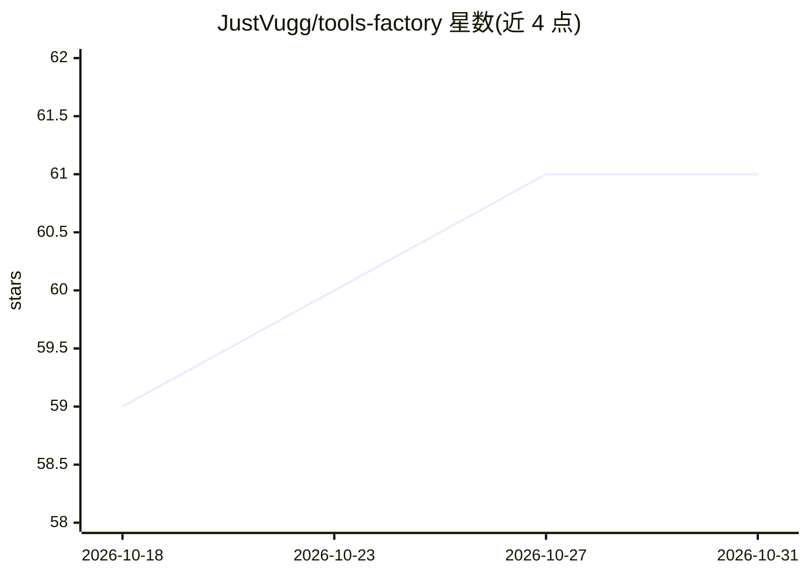

# JustVugg/tools-factory

⭐ 61 · Go · MIT · 推送 2026-07-06 · [GitHub](https://github.com/JustVugg/tools-factory) · 个人维护

**把任意 API 表面生成为经验证的 AI agent 工具（Go CLI/MCP/技能）**

面向开发者的工具生成工厂：从 OpenAPI/GraphQL/HAR/Postman/curl 等输入生成 Go CLI、stdio MCP 服务器、Claude/OpenClaw 技能，并用 go build、CLI 冒烟、MCP 握手与 Go 测试验证，写出 proofs/verification.json（无证明不算 Grade A）。附 try 命令自动分类站点、AES-GCM 令牌库、lockfile/diff/watch、快照回放、LLM 结构化抽取（Anthropic/OpenAI/Ollama 可选）。内置 21 个已验证目录条目。明确不绕过反爬与 CAPTCHA；npm 包未发布，需从源码仓库安装（需 Node.js 20+ 与 Go）。

## 筛选速览

| 维度 | 判定 | 备注 |
|---|---|---|
| AI 角色 | `ai-ecosystem` | LLM/agent 周边工具 |
| 许可风险 | `permissive` | MIT |
| 部署形态 | `library` | 以包/库形式分发 |
| 模型依赖 | local-ok | 支持本地模型 |
| 硬件要求 | — | 无带数字的原话,不猜 |
| 安装摩擦 | `medium` | 含编译或系统依赖之一 |
| 成熟度 | `idea` | |

## 能力要点

- 从 OpenAPI/GraphQL/HAR 生成 Go CLI + MCP 服务器 + Claude/OpenClaw 技能
- 验证门控：build/cli 冒烟/MCP 握手/Go 测试产出 proofs/verification.json
- 快照/回放确定性模式、AES-GCM 共享令牌库、lockfile+diff+watch
- LLM 抽取支持 Anthropic/OpenAI/Ollama 提供方

## 适用场景

- 把无文档的 JSON API 转成 agent 可调用的 MCP 工具
- 为 GitHub/Stripe 等公开 OpenAPI 生成经验证的 CLI 与技能
- 对生成工具做 CI 中的确定性离线回放测试

## 场景标签

`代码生成` · 领域:编码与开发

## 证据(README 行号)

> L5: **A verified tool factory for AI agents.** From any API surface to safe, verified tools any agent runtime can use — 
> L22: 3. **generate** Go CLI + MCP server + Claude skill + OpenClaw skill
> L23: 4. **verify** with build + cli smoke + MCP handshake + Go tests → `proofs/verification.json`
> L43: |**`verify`**|Runs `go build`, CLI smoke test, MCP handshake, `go test` — writes `proofs/verification.json`. **No p

## 星数曲线

2026-10-18 59 → 2026-10-31 61（+2）

---
*卡片 v1 · prompt 1.4 · 生成 2026-10-24 · 置信度 mid · 依据 README sha `675472a8243c` · [字段定义](../../DATASET.md)*
